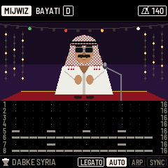

# DABKE

An Arabic wedding keyboard for the M-VAVE FM-1. Free, open source, public beta.

DABKE plays maqam scales with quarter tones on any note over dabke and shaabi rhythms: maqsum, baladi, saidi, dabke,
khaliji, chobi and more. Its voices are mijwiz, zurna, keyboard lead, violin, ney, accordion, strings, organ, buzuq,
oud, qanun, brass and square, with a drone, trills, glides and automatic ornaments. Lean on a key and the note bends. It has eight
tracks with loops and a step sequencer, each track with its own sound, bass and backing from the left hand, an arpeggio, delay, reverb and a wedding
PA. An Akai MIDImix plugged into the FM-1's USB port works as its mixer.

Made by [STUDIOMORPHIK](https://studiomorphik.com).

## Install

The easiest way is the installer page, [studiomorphik.com/dabke/install](https://studiomorphik.com/dabke/install/):
open it in Chrome or Edge on a computer, with the FM-1 on USB. You can also download `dabke-X.Y.fwsc` from
[the releases](https://github.com/wissamsader/dabke/releases) and install it with any FM-1 installer that takes a
`.fwsc` package. To try it without an FM-1, [play it in your browser](https://studiomorphik.com/dabke/emu/).

The manual is at [studiomorphik.com/dabke/manual](https://studiomorphik.com/dabke/manual/) and in
[docs/MANUAL.md](docs/MANUAL.md).

To go back to another firmware, install it the same way.

## Beta

This is a beta. It was tested on one FM-1, a unit with the newer flash chip (B36014). The package also accepts the
older chip (856014), which has not been tried yet.

Some other FM-1 firmwares keep their saves in the same part of the flash. After you install one of them, DABKE can
start fresh when you come back to it.

If something goes wrong, please open an [issue](https://github.com/wissamsader/dabke/issues): what you did, what
happened, and which DABKE version you installed.

## Build from source

DABKE is an app on [fm1-base](https://github.com/charlesvestal/fm1-base). The `base/` folder is a git submodule: fm1-base
at `f66ac4a` with one addition DABKE needs, `APP_UPDATE_SAVE` (the app saves its unsaved work when an update starts),
on the `dabke` branch of [wissamsader/fm1-base](https://github.com/wissamsader/fm1-base/tree/dabke).

    git clone --recursive https://github.com/wissamsader/dabke
    cd dabke
    python3 base/tools/build.py app --host            # the host simulator
    ./run_tests.sh                                    # its tests: every one must say ok
    python3 base/tools/build.py app --web             # the browser version (needs Emscripten): app/build/emu/
    python3 base/tools/build.py app --release 0.19    # the FM-1 package: app/build/dabke-0.19.fwsc

The FM-1 package needs JieLi's toolchain and AC79 SDK in a container; fm1-base's README explains the setup. The
simulator and its tests need only a C compiler and Python 3.

| Path | What |
| --- | --- |
| `app/app.c`, `app/app.h` | The panel: pages, knobs, tracks, recording, the step sequencer, saving, the MIDImix |
| `app/dabke.c`, `app/dabke.h` | The sound engine: voices, maqams, ornaments, the rhythm box, effects |
| `app/dabke_rhythms.h` | The rhythms |
| `app/dabke_maqamat.h` | The maqamat, as their notes |
| `app/panel.c`, `app/scene.c` | The home screen and the singer's scenes |
| `app/words.tsv` | The screen reader's words |
| `app/tests/` | The simulator's tests |
| `app/fm1.toml` | Build settings, package identity (`FM-1_65`) and the text for firmware hubs |
| `docs/` | The manual and its pictures |
| `fmhub.json`, `firmware.json` | What firmware hubs show |

### Adding a maqam

The maqamat are in `app/dabke_maqamat.h`, one line each, written as their notes from the tonic:

    {"Rast", "C D Eh F G A Bh"},

The notes are the letters A to G, each with `b` for a flat, `#` for a sharp or `h` for a half flat (a quarter tone
flat), with one space between them. The first note is the tonic, where the MAQAM page puts the maqam. DABKE turns the
notes into its tuning when it starts. Put a new maqam at the end of the list, and never move or remove one above it:
saved songs keep their maqam by its place in the list. Then build the simulator and run the tests: `app/tests/maqam.txt`
fails on a note it cannot read or on two notes that fall on one key.

## Licence

DABKE is MPL-2.0 ([LICENSE](LICENSE)). Copyright (C) 2026 STUDIOMORPHIK. `app/app.c` and `app/app.h` began as fm1-base's
template, Copyright (C) 2026 Charles Vestal, MPL-2.0.

The FM-1 package also carries:

- fm1-base by Charles Vestal and felucca-bsp, from Felucca by Leo Kuroshita (Hügelton Instruments), MPL-2.0. See
  fm1-base's [LICENSING.md](https://github.com/charlesvestal/fm1-base/blob/main/LICENSING.md).
- Files from JieLi's AC79 SDK that every FM-1 package needs, Copyright (c) Zhuhai Jieli Technology Co., Ltd., Apache
  License 2.0 ([LICENSES/Apache-2.0.txt](LICENSES/Apache-2.0.txt)).
- Barlow Semi Condensed, drawn into the screen's text, Copyright The Barlow Project Authors, SIL Open Font License 1.1
  ([LICENSES/OFL-1.1-Barlow.txt](LICENSES/OFL-1.1-Barlow.txt)).

All of DABKE's sounds are made by its own code. It carries no samples.
