# DABKE

DABKE is a free firmware for the M-VAVE FM-1 that makes it an Arabic wedding keyboard. It has lead voices with quarter tones on any note, a drone, bass and backing from the left hand, and a rhythm box of darbuka, tabl, riq, daf, sagat, kick and claps. Eight tracks record what you play, and an Akai MIDImix can work as its mixer.

**Status.** This is version 0.19, a free public beta from STUDIOMORPHIK. It has been tested on one FM-1.

**New in 0.19.** HOLD: press the key of a held note again and that note stops; the other held notes go on. OCT- and OCT+ take the held notes up or down with their keys, and they stay held. A new sound on a track keeps its held notes sounding (see HOLD).

**New in 0.18.** Hold SAVE while you switch the FM-1 on to start fresh: every setting, sound, loop, step, lock and MY SOUND goes back to how DABKE was on its first start (see Saving). The maqam page shows every note of the maqam white and every other note grey, on the black keys as on the white ones.

**New in 0.17.** Each of the eight tracks keeps its own sound, so SAZ on track 2 and BUZUQ TREMOLO on track 3 play at the same time. SELECT on a picked track offers the 22 ready sounds and your MY SOUNDs, and the SOUND and ORNAMENTS pages edit the picked track's sound. The effects, the tempo, the maqam and the rhythm are still shared by the whole song. Saves from 0.16 load and sound as they did.

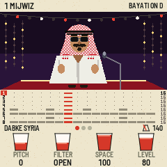

---

## Contents

1. Install
2. The panel
3. The home page
4. The eight tracks
5. Sounds
6. Maqam and quarter tones
7. Rhythms and tempo
8. The left hand, bass and backing
9. The drone
10. Velocity and key pressure
11. Recording
12. Steps and locks
13. HOLD
14. The arpeggio
15. Saving
16. The SOUND page
17. The ORNAMENTS page
18. The EFFECTS page
19. The RHYTHM page
20. The Akai MIDImix
21. MIDI and USB audio
22. Troubleshooting
23. Credits

---

## 1. Install

DABKE installs from the browser, with Chrome or Edge on a computer. Connect the FM-1 by USB, open the [DABKE installer](https://studiomorphik.com/dabke/install/) and follow its steps. The browser asks once to allow MIDI: allow it. Keep the cable in while it writes.

You can also install DABKE with any FM-1 installer that takes a `.fwsc` package. To try DABKE first, the site's Emulator page runs it in your browser.

To go back to another firmware, install that one the same way. When an installer starts writing over USB while DABKE runs, DABKE first saves anything it had not saved yet. When you install DABKE again, it goes on where you left it: its saves stay in the flash, unless the other firmware wrote over them (see below). To begin again from DABKE's first start instead, hold SAVE while you switch the FM-1 on (see Start fresh, in Saving).

DABKE 0.17 loads what 0.16 saved, and it sounds as it did. Going back to 0.16 after 0.17 has saved starts 0.16's settings fresh. The kept sounds stay.

> Some other FM-1 firmwares keep their saves in the same part of the flash as DABKE. After you install one of them, DABKE can start fresh when you come back to it, as on its first start.

---

## 2. The panel

| Control | What it does in DABKE |
| --- | --- |
| Keys | The 27 keys, F3 to G5, play the picked track (see The eight tracks). In step mode the white keys are the steps. |
| OCT- · OCT+ | The octave, from -3 to +3. In step mode: the page of steps before or after. |
| MASTER | The volume. |
| SELECT | On the home page: the picked track's sound. On a knob page: the row. On the maqam page: the note to tune. On the save page: the place. |
| ALGO | The tempo, 2 beats a minute a click. |
| PRESET | The rhythm. |
| K1 to K4 | On the home page: the picked track's EFFECT, FILTER, PITCH and VOLUME. With ALL picked: the volume of the lead, the drone, the left hand and the drums. On a knob page: the row's four knobs. |
| HOME | The home page. In step mode, the step view. |
| SEL | On the home page: tap it for the next track, or hold it and press one of the first eight white keys to pick that track. On any other page: the maqam page. |
| ENV | The SOUND page. Press it again for the next row. |
| LFO | The ORNAMENTS page. Again: the next row. |
| FX | The EFFECTS page. Again: the next row. |
| GLO | The RHYTHM page. Again: the next row. |
| EDIT | Tap it: HOLD. Hold it and press a key: that note goes a quarter tone flat, or back. In step mode, with a step held: that step's locks go. |
| SAVE | Keeps a track's sound in one of eight places (see Saving). |
| ARP | Tap it: the arpeggio on or off. Hold it: the arpeggio's panel. |
| SEQ | Tap it: step mode on or off. Hold it a second: every recording, every written step and every lock is cleared. |
| PLAY | Starts the rhythm and every track. Tap it again to stop. While it runs, hold it for 0.4 s: a fill-in. |
| REC | The picked track records when you let go. Press it again to stop. Hold it a second: the last take is gone. |

PLAY is green while the rhythm runs. The button of the page you are on is lit. ARP is lit while the arpeggio is on, SEQ in step mode, REC while a track records or waits to, and EDIT while you hold it.

After most actions, a short message takes the place of the top line for a moment, for example KEYS PLAY TRACK 3: LEFT HAND STRINGS.

---

## 3. The home page

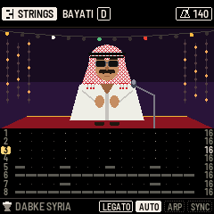

| Part | What it shows |
| --- | --- |
| Top line | The picked track's sound in a white box, with a small sign for its kind. With ALL picked, track 1's sound. Then the maqam and its root, and CHANGED if you retuned a note by hand. At the right, the tempo, with a metronome that swings on the beats while the rhythm runs. |
| The singer | The singer claps on the beat and dances while the rhythm runs. HOME SCENE on the ORNAMENTS page picks the picture. |
| Lanes | The eight tracks, a lane each, numbered 1 to 8. A yellow number is the picked track, a red one is recording. A small yellow bar by the number: the track plays something of yours. Along the lane, the track's steps: a block where something of yours begins, a low grey block where the rhythm plays, a blue line for a lock, amber for the step playing now. The number at the right is the track's length in steps. A muted track is dimmed. |
| Bottom line | The rhythm, and the one added to it. While a track records: its number and bar, in red. At the right: the HOLD mark while notes are held, how the sound on the SOUND page plays (LEGATO, MONO or POLY) and its ornament (lit while one is on), ARP (lit while on, with a small padlock when ARP LATCH is on), REC while recording, and SYNC (lit when SYNC START is on). |

HOME SCENE (the ORNAMENTS page, row 4, K1) has four pictures: PORTRAIT, STAGE (as DABKE starts), DANCERS and CASSETTE.

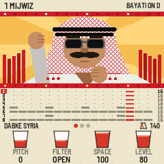

---

## 4. The eight tracks

| Track | As DABKE starts |
| --- | --- |
| 1 | LEAD: the lead instrument, MIJWIZ. |
| 2 | DRONE: the drone. |
| 3 | LEFT HAND: the left hand's own sound and the backing chords, STRINGS. |
| 4 | BASS LINE: the bass. |
| 5 | KICK. |
| 6 | DARBUKA, TABL: dum, tek, ka, slap, tabl, stick and daf. |
| 7 | CLAPS: claps and snare. |
| 8 | RIQ, SAGAT: riq, sagat and shaker. |

### Picking a track

On the home page, tap SEL to go round: ALL, track 1, track 2 and so on to track 8, then ALL again. Or hold SEL and press one of the first eight white keys, F3 for track 1 up to F4 for track 8. While SEL is held those eight keys light up, the picked one brightest. The screen says what the keys play now, for example KEYS PLAY TRACK 4: ROUND.

### What the keys play

The keys play the picked track over the whole keyboard, whether the rhythm runs or not. A note sound plays notes. A drum sound plays its drums in turn up the keys: the kick on every key, or on track 6 dum, tek, ka, slap, tabl, stick and daf, then dum again. While a track records, the keys play that track.

With ALL picked, the keys play as LEFT KEYS sets them (the RHYTHM page, row 4, K1):

- SAME: the whole keyboard plays the lead.
- SPLIT: the twelve lowest keys, F3 to E4, play the left hand's own sound (track 3), the rest the lead.
- BASS: the twelve lowest keys give the bass and the backing their chord, the rest play the lead.

With SPLIT or BASS, those twelve keys are lit dim.

### Any sound on any track

With a track picked, turn SELECT on the home page to change its sound. It goes through the track's own family first, then the others in this order: LEAD, DRONE, LEFT HAND, BASS, KICK, DARBUKA, CLAPS, RIQ. LEAD's sounds are the 22 ready sounds, then the MY SOUNDs you kept (see Sounds). A note sound makes the track a track of notes: its keys play notes and it records loops. A drum sound makes it a drum track: its keys play drums and it records steps.

Each track keeps its own sound. SAZ on track 2 and BUZUQ TREMOLO on track 3 play at the same time, each with its own settings. The screen names a lead sound by its own name, as in TRACK 2: SAZ. A sound of another family whose name is shared gets its family in front, as in TRACK 2: DRONE ORGAN.

### Yours and the rhythm's

The rhythm plays tracks 5 to 8, and with LEFT KEYS on BASS also the bass line (track 4) and the backing (track 3). Once you record, write or remove anything on one of those tracks, it is yours: the rhythm, its variations, its added voices and its fill-ins leave it alone. Cleared, it follows the rhythm again.

---

## 5. Sounds

The ready sounds are MIJWIZ, MIJWIZ BUZZ, ZURNA, KEY LEAD, FAST LEAD, WHISTLE LEAD, SQUARE LEAD, VIOLIN, STRINGS, NEY, ACCORDION, ORGAN, BUZUQ, BUZUQ TREMOLO, SAZ, OUD, QANUN, QANUN TREMOLO, BRASS, WEDDING ZURNA, CASSETTE MIJWIZ and SHAABI LEAD. After them come the sounds you kept, MY SOUND 1 to MY SOUND 8. With ALL picked, SELECT on the home page goes through them for track 1. With a track picked, they are its LEAD sounds (see Any sound on any track).

Each track keeps its own full sound: its instrument, the SOUND page's knobs (apart from VEL AMOUNT and the arpeggio), the vibrato and the ornaments. The effects (the EFFECTS page's first three rows), the tempo, the maqam, the rhythm, the mixer, KEY TOUCH, PRESSURE, VEL AMOUNT and the arpeggio are shared by all the tracks.

Picked with ALL, a ready sound goes on track 1 and also sets the effects: WEDDING ZURNA brings its PA and drive, CASSETTE MIJWIZ its tape wobble and hiss. Picked on a track, it sets that track's sound alone and never the effects, because the effects work on the whole song. With ALL picked, a kept sound also brings back the effects and which sound each track plays (see Keep a sound). The drone, the volumes, the mixer, the rhythm, the arpeggio and the maqam stay as they are.

### The lead's instruments

INSTRUMENT on the SOUND page (row 1, K1) is the instrument of the sound the page shows (see The SOUND page). Each ready sound is built on one of them: BUZUQ TREMOLO and SAZ on BUZUQ, for example. There are thirteen:

| Instrument | What it is |
| --- | --- |
| MIJWIZ | Two reed pipes tuned a little apart, with their beating, a nasal body and a buzz. |
| ZURNA | A double reed through a narrow bell: loud and nasal. |
| KEY LEAD | The keyboard lead: two saw waves through a resonant filter. |
| VIOLIN | A bowed string. |
| NEY | A pure tone with breath tuned to the note. |
| ACCORDION | Reeds. |
| STRINGS | A string section, slow to start. |
| ORGAN | An organ. |
| BUZUQ, OUD, QANUN | Plucked strings. |
| BRASS | Brass, its filter opening as each note starts. |
| SQUARE | A square-wave lead. |

Each instrument brings its own TONE, BUZZ, PIPES APART, BREATH, BODY, ATTACK, RELEASE, GLIDE and PLAY. The SOUND page shapes one track's sound at a time (see The SOUND page). The left hand and the drone play their instruments with their own settings, and follow track 1's TRANSPOSE, TUNE and vibrato.

### Every family's sounds

| Family | Sounds |
| --- | --- |
| LEAD | The 22 ready sounds, then the MY SOUNDs you kept |
| LEFT HAND | MIJWIZ, ZURNA, KEY LEAD, VIOLIN, NEY, ACCORDION, STRINGS, ORGAN, BUZUQ, OUD, QANUN, BRASS, SQUARE |
| DRONE | MIJWIZ, ORGAN, STRINGS, ACCORDION, NEY, VIOLIN, BRASS |
| BASS | ROUND, SYNTH, BUZZ, WOODY, PICKED |
| KICK | MACHINE, BOOM, TIGHT, THUMP |
| DARBUKA | CLAY, DEEP, BRIGHT, METAL |
| CLAPS | HANDS, CROWD, SNAPS, ROOM |
| RIQ | BRASS, BRIGHT, DARK, LONG |

DABKE plays up to 16 notes at once, the drone apart. When the FM-1 is busy it plays fewer, and the oldest note stops for the newest.

---

## 6. Maqam and quarter tones

Press SEL on any page but the home page to open the maqam page. It shows the twelve notes of an octave, C to B, as a keyboard. Every note of the maqam is white and every note outside it is grey, on the black keys as on the white ones. The black keys are the short, narrow ones between the white keys, each with a black edge. A retuned note is amber, with its cents. The red frame marks the note SELECT points at. Under the keys, the maqam's scale is written out, with a half-flat sign on each quarter-tone note.

| Control | What it does |
| --- | --- |
| SELECT | Moves the red frame along the twelve notes. |
| K1 CENTS | That note's tuning, from -100 to +100 cents. |
| K2 MAQAM | The maqam. Each comes on its usual root, with its notes tuned. |
| K3 ROOT | Moves the maqam to another root. |
| K4 DEPTH | How flat a quarter tone flat is: 20 to 80 cents, 50 as DABKE starts. |

DABKE starts on BAYATI ON D. The maqamat, on their usual roots:

| Maqam | Root | Its notes |
| --- | --- | --- |
| PLAIN | C | C, D, E, F, G, A, B. No quarter tones. |
| RAST | C | C, D, E half flat, F, G, A, B half flat |
| BAYATI | D | D, E half flat, F, G, A, Bb, C |
| SABA | D | D, E half flat, F, F#, A, Bb, C |
| SIKAH | E half flat | E half flat, F, G, A, B half flat, C, D |
| HUZAM | E half flat | E half flat, F, G, Ab, B, C, D |
| IRAQ | B half flat | B half flat, C, D, E half flat, F, G, A |
| BAYATI SHURI | D | D, E half flat, F, G, Ab, B, C |
| HIJAZ | D | D, Eb, F#, G, A, Bb, C |
| HIJAZ KAR | C | C, C#, E, F, G, Ab, B |
| KURD | D | D, Eb, F, G, A, Bb, C |
| NAHAWAND | C | C, D, Eb, F, G, Ab, B |
| AJAM | Bb | Bb, C, D, Eb, F, G, A |
| NAKRIZ | C | C, D, Eb, F#, G, A, Bb |
| SABA ZAMZAM | D | D, Eb, F, F#, A, Bb, C |

### A quarter tone on any note

Hold EDIT and press a key: that note goes a quarter tone flat, in every octave. Press it again with EDIT held: it is back. This works on every page. While EDIT is held, the keys tuned flat are lit dim. For any other amount, use SELECT and K1 CENTS on the maqam page.

Once a note is tuned by hand, the maqam page says CHANGED BY HAND, and the home page's top line says CHANGED. Choosing a maqam or a root again tunes the notes as the maqam has them.

The tuning goes to every track's notes, the drone, the arpeggio and notes coming in over MIDI.

---

## 7. Rhythms and tempo

Turn PRESET to change the rhythm. With the rhythm stopped, the tempo goes to the new rhythm's own. While it runs, the tempo stays. Turn ALGO for the tempo, from 40 to 240.

| Rhythm | Group | Its tempo |
| --- | --- | --- |
| DABKE SYRIA | Levant | 140 |
| DABKE LEBANON | Levant | 116 |
| DABKE 3-3-2 | Levant | 132 |
| TABL ZURNA | Levant | 120 |
| MAQSUM | Egypt | 100 |
| BALADI | Egypt | 96 |
| SAIDI | Egypt | 112 |
| WAHDA | Egypt | 84 |
| MALFUF | Egypt | 120 |
| AYOUB | Egypt | 116 |
| FALLAHI | Egypt | 132 |
| KARACHI | Egypt | 116 |
| ZAFFA | Egypt | 100 |
| SHAABI | Egypt | 112 |
| MAHRAGAN | Egypt | 128 |
| KHALIJI | Gulf | 88 |
| CHOBI | Iraq | 138 |
| CHAABI 6/8 | Maghreb | 104 |
| SAMAI 10/8 | Classic | 80 |
| LAZ 7/8 | Classic | 100 |
| MASMUDI 8/4 | Classic | 92 |

Each rhythm has its own bass line and backing pattern for the left hand.

PLAY starts the rhythm and every track's loops and steps. PLAY again stops everything. While the rhythm runs, hold PLAY for 0.4 s: a fill-in plays in the last two beats of the bar (FILL IN), and the rhythm goes on.

The RHYTHM page has the rest: swing, accents, variations, added claps, riq, sagat and kick, automatic fill-ins, a second rhythm on top, SYNC START and the drum kit (see The RHYTHM page).

### Your own rhythm

Make a rhythm your own by writing or recording on the drum tracks, 5 to 8, in step mode or live (see Steps and locks). Each track you change is yours and the others go on following the rhythm. Change the rhythm with PRESET and your tracks stay as you made them, while the untouched ones follow the new rhythm.

---

## 8. The left hand, bass and backing

These work with ALL picked, as LEFT KEYS sets the twelve lowest keys (F3 to E4).

With LEFT KEYS on SPLIT, the left keys play track 3's sound (LEFT SOUND, the RHYTHM page, row 5, K1). They stay at their own pitch whatever the octave.

With LEFT KEYS on BASS, hold a left key: its note is the chord's root (with several held, the lowest). With the rhythm stopped, the bass and the chord sound while you hold it. With the rhythm running, the bass line (track 4) and the backing (track 3) play on that root, as BASS PLAYS and BACKING say, and go on with it after you let go, until you hold another left key.

| Knob | Choices |
| --- | --- |
| BASS PLAYS | PATTERN: the rhythm's bass line. ROOT: the root on the rhythm's bass hits. OCTAVES: the root and its octave in turn. WALKING: up and down the maqam, a note a beat. NONE. |
| BACKING | STABS: short chords on the rhythm's backing hits. HELD: the chord held. ARPEGGIO: the maqam's notes in turn, eighths. NONE. |
| CHORD TYPE | FIFTHS: root, fifth and octave. MAQAM: the root with the maqam's third and fifth. |

LEFT SOUND, BASS SOUND, BASS TONE and BASS DECAY are on row 5. With ALL picked, K3 on the home page turns the left hand's volume, with the bass line's when LEFT KEYS is on BASS.

Record or write something on track 3 or 4 and it is yours: the automatic backing or bass line on that track goes silent until you clear it.

### SYNC START

With SYNC START on (the RHYTHM page, row 3, K4), the first left key starts the rhythm. It needs ALL picked and LEFT KEYS on SPLIT or BASS.

---

## 9. The drone

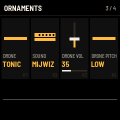

The drone holds the maqam's tonic, tuned as the maqam has it. It sounds while you play the lead (and 0.6 s after), while the rhythm runs, while the left hand holds a chord, and while you play its own track, even with DRONE on OFF. Its controls are on the ORNAMENTS page, row 3, the same whichever track is picked:

| Knob | What it does |
| --- | --- |
| DRONE | OFF, TONIC (as DABKE starts), TONIC + 5TH, or LEFT KEY: the root of the left hand's chord while you hold one (LEFT KEYS on BASS), the tonic otherwise. |
| SOUND | MIJWIZ, ORGAN, STRINGS, ACCORDION, NEY, VIOLIN, BRASS. |
| DRONE VOL | 0 to 100. Turned up while the drone is OFF, it switches the drone on, on the tonic. |
| DRONE PITCH | LOW (C2 to B2) or MIDDLE (an octave up). |

With ALL picked, K2 on the home page is the drone's volume. A ready sound leaves the drone as it is. Track 1's TRANSPOSE, TUNE and vibrato move the drone too.

The drone is track 2. With it picked, a key moves the drone to that note, in the drone's own octave. It goes back to the tonic when the rhythm starts or stops. Record on track 2 and the drone moves with the loop. With the drone's track picked, the SOUND and ORNAMENTS pages edit track 1's sound (see The SOUND page).

---

## 10. Velocity and key pressure

### Velocity

KEY TOUCH (the ORNAMENTS page, row 4, K4) has two choices. VELOCITY, as DABKE starts: each note lands as hard as you play it, on all 27 keys. PLAIN: every note lands the same, at 100. KEY TOUCH sets only how hard a note lands. VEL AMOUNT (the SOUND page, row 4, K2) sets how much that changes the loudness: at 0, every note is equally loud. Both are shared by all the tracks.

### Pressure

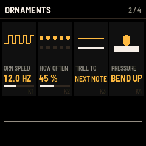

Press harder on a key you hold, and PRESSURE (the ORNAMENTS page, row 2, K4) says what happens. It works by itself, whatever KEY TOUCH says, and it is the same for every track.

| PRESSURE | What a harder press does |
| --- | --- |
| NOTHING | Nothing. |
| BEND UP | Bends the note up, by BEND RANGE at full pressure. As DABKE starts. |
| BEND DOWN | Bends the note down, by BEND RANGE at full pressure. |
| VIBRATO | A vibrato that deepens as you press, at VIB SPEED. |
| BRIGHTER | Opens the sound's tone. |

BEND RANGE is part of each track's sound, on the SOUND page, row 4, K3: 1/4 TONE, 1/2 TONE (as DABKE starts), 1 TONE or 1 1/2 TONE. A lead sound bends by its own BEND RANGE, the left hand and the bass line by track 1's.

Only the 20 lowest keys sense pressure: F3 to C5. The top seven keys, C#5 to G5, sense velocity but not pressure.

The pressure goes to the notes the keys are playing, on whichever track that is: the lead, the left hand, the bass line, any note sound. With ALL picked, each key's pressure goes to its own track. A light touch does nothing, so a resting finger does not bend. Drum keys have no pressure. The pressure does not move a loop's notes as they play back, and it is not recorded. It does not bend the drone. BRIGHTER changes every instrument but ORGAN, BUZUQ, OUD and QANUN, and it does not change the bass sounds.

With KEY TOUCH on PLAIN and PRESSURE on NOTHING, the keys work as plain switches.

---

## 11. Recording

Each track records what you play. A track with a note sound records a loop. A drum track records hits on its steps.

1. Pick the track. With ALL picked, REC records track 1, the lead.
2. Press REC and let go. If the rhythm runs, the track records at once. If not, it waits: the screen says TRACK 1: PLAY TO START and REC shows framed in red. Your first key starts the rhythm and the recording, or press PLAY.
3. Play. The bottom line counts the bars, in red.
4. Press REC again. The recording stops at once, and the loop plays from the next bar. The screen says what was kept, for example TRACK 1: 1 BAR, 1 TAKE.

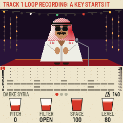

Notes land on the nearest step of the rhythm, or of the arpeggio when it is on and faster. A first take keeps every bar you began, up to eight bars. At eight it ends by itself and plays.

REC on a track that has a loop records over it: the bottom line says ADDING, and what you play is a new take, the loop as long as before. Stopping the rhythm with PLAY also ends a recording, and keeps it. One track records at a time.

Hold REC a second, with nothing recording: the picked track's last take is gone (LAST TAKE GONE). Again: the one before. With nothing left, the screen says TRACK 3 EMPTY, or BACK TO THE RHYTHM for a track the rhythm plays. A track keeps 16 takes apart; past that, the oldest two become one.

A drum track records the drums you play on the keys, each hit on the step it falls on. It is yours from the first hit. With the rhythm stopped, your first hit starts it.

While a track records, turning its EFFECT, FILTER or PITCH (K1 to K3 on the home page, or its MIDImix knobs) is kept as locks on the steps the recording passes, so the move comes back with the loop. Its volume is not kept.

The loops play whenever the rhythm runs. A track holds up to 128 notes, and all the tracks 512: past that, NO ROOM FOR MORE NOTES. Hold SEQ a second to clear every recording, every written step and every lock (ALL RECORDINGS CLEARED).

---

## 12. Steps and locks

Tap SEQ for step mode. It starts nothing: the rhythm and the loops go on as they were. With ALL picked, it picks the track you picked last (track 1 the first time). In step mode SEL goes round tracks 1 to 8, and HOME shows the step view.

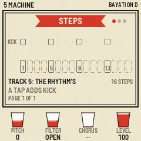
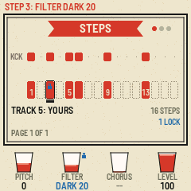

| Part | What it shows |
| --- | --- |
| Top line | STEPS, and the page shown, as PAGE 1 OF 2. With a step held, that step's locks instead. |
| Upper half | A drum track: its drums lane by lane. A note track: its notes by pitch, as long as they sound. |
| Row of steps | The steps as the white keys have them: filled where something of yours begins, outlined where the rhythm plays, dotted where empty. A blue padlock on a locked step, a line under the step playing, a frame round the step held. |
| Two lines | The track and whose it is (YOURS, THE RHYTHM'S or EMPTY) and its length. What a tap adds, and the track's locks counted. |
| K1 to K4 | The track's EFFECT, FILTER, PITCH and VOLUME. |

### The white keys are steps

The 16 white keys are the steps of the page shown, from the left. A white key is lit where something begins, at a second level where a lock is, and dim on the step playing. The black keys go on playing the track's sound.

A page is a bar: 16 steps, or as many whole bars of the rhythm as fit in 16 (12 in 6/8, 14 in 7/8, 10 in 10/8). OCT- and OCT+ show the page before and after. OCT+ on a track one bar long gives it a second bar, with the first bar copied in if the second is empty. LENGTH (the EFFECTS page, row 4, K2) sets one bar or two, and for a loop played live, also the length it was played.

- Tap an empty step. A drum track gets the drum shown after A TAP ADDS: the drum you played last on it, or the one DRUM picks (the EFFECTS page, row 4, K4). A note track gets the notes HOLD holds on it, or else the note or chord you played last on it, or else the maqam's tonic, one step long.
- Tap a step with something on it: it goes, and its locks with it.
- Hold a step and press keys. On a note track, their notes become the step's in place of what was there, up to four. On a drum track, the black key's drum becomes the step's only drum.
- A key held longer than 0.4 s and let go with nothing done changes nothing.

### Locks

Hold a step and turn a knob: that knob is locked on that step. From that step to the track's next step with a note or a hit, the knob holds the lock's value, then goes back. The top line names the step's locks, for example STEP 3: FILTER DARK 20, and the knob's value shows in blue. A small padlock by a knob's name means the track has a lock of that knob somewhere.

Most knobs that turn through values can be locked: K1 to K4 of the step view, the knobs of the SOUND, ORNAMENTS, EFFECTS and RHYTHM pages, and the MIDImix's knobs and faders. On a knob page in step mode, the track's steps show under the knobs, so you can hold a step and lock that page's knob. A lock of one of a sound's knobs, such as TONE or VIB DEPTH, works on the sound the page shows and no other: VIB DEPTH locked on a step of track 2, with SAZ on it, changes track 2's vibrato, and the other tracks keep theirs. When a control cannot be locked, the screen says so: the tempo, the rhythm, choices such as ORNAMENT, a track's mute and FADE are among them.

- An empty step held while a knob turns gets a lock and nothing else. Tap it to remove the lock.
- On a drum track, hold a step and turn SELECT: that step's hits play another drum sound, the track's own family first, then the other drum families. Turn back to the track's own sound to remove it. Note sounds cannot be locked to a step.
- EDIT with a step held removes that step's locks. Hold EDIT a second with no step held: all the picked track's locks go.
- There is room for 240 locks in all. Past that, NO ROOM FOR MORE LOCKS.

Tap SEQ again to leave step mode. The track stays picked and the keys play it.

---

## 13. HOLD

Tap EDIT on any page, or SOLO on the MIDImix, while you hold keys: their notes go on sounding after you let go, on the track they were played on (HOLD: 2 NOTES). The held keys stay lit, and the bottom line shows the HOLD mark. Notes you play meanwhile are not held. Tap EDIT with other keys down: those are held instead. Tap it with no key down: the held notes stop (HOLD OFF).

Press the key of a held note again and that note stops at once, while the other held notes go on (HOLD: 1 NOTE); that press plays nothing else, and its key goes dark. This works whatever track the keys play now and whatever the octave. A note held from a MIDI keyboard stops the same way when you play it again there.

OCT- and OCT+ take the held notes up or down an octave with their keys, and they stay held: the same key still stops its note. The left keys set to SPLIT or BASS keep their pitch, as they always do. The track's PITCH, its TRANSPOSE and TUNE, and a quarter tone set with EDIT move the held notes too, and they stay there. A pitch wheel and the keys' pressure bend held notes only while you move them.

A new sound on a track keeps its held notes sounding, in the new sound. A drum sound holds no notes, so on a drum sound they stop.

A held left key keeps its chord for the bass and backing. With the arpeggio on, held notes go on arpeggiating; the key of a held note takes it out of the arpeggio, with ARP LATCH on too. In step mode the white keys are steps, so they do not stop held notes there, and the held notes are what a tap adds. While recording, a held note is kept for as long as it sounds. Nothing is held when DABKE starts.

EDIT held while you press a key tunes that key, and is not a HOLD.

---

## 14. The arpeggio

Tap ARP to switch the arpeggio on or off (ARPEGGIO ON). It plays the keys you hold on a lead sound, track 1 or any track with a lead sound, a note at a time on its own grid. It keeps time with the rhythm when it runs, and with the tempo when not. Its notes keep their quarter tones, and a recording on its track keeps them.

Hold ARP for its panel: eight controls in two rows, the framed row on K1 to K4. SEL or SELECT moves to the other row. Let go of ARP after using the panel and the arpeggio stays on or off as it was. The same eight are on the SOUND page, rows 5 and 6.

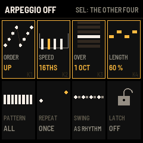

| Control | Choices |
| --- | --- |
| ARP ORDER | UP, DOWN, UP DOWN, DOWN UP, AS PLAYED, ANY, CHORD (all the notes together), IN OUT, THUMB (the lowest note between each of the others). |
| ARP SPEED | QUARTERS, 8THS, TRIPLETS, 16THS (as DABKE starts), SEXTUPLETS, 32NDS. |
| ARP OVER | 1 OCT, 2 UP, 3 UP, 4 UP, 2 DOWN, 3 DOWN, 2 BOTH WAYS: the octaves it walks over. |
| ARP LENGTH | How long each note sounds, from 10 % of its step up to TIED, each note running into the next. |
| ARP PATTERN | ALL, 3-3-2, MAQSUM, SAIDI, GALLOP, OFFBEATS, PAIRS, ACCENTS: a rhythm of eight steps, with rests and accents. |
| ARP REPEAT | ONCE, TWICE, 3 TIMES, 4 TIMES: each note that many times before the next. |
| ARP SWING | AS RHYTHM, NONE, LIGHT, MEDIUM, HEAVY, FULL. |
| ARP LATCH | OFF or ON. ON: it goes on after you let go of the keys, and the next keys you press start a new set. |

---

## 15. Saving

DABKE keeps everything you set by itself: every track's sound, every page's settings, the maqam, the rhythm and the tempo, the mixer, the loops, the steps and the locks. They come back when the FM-1 starts.

It writes them a few seconds after your last change, in a quiet moment: with the rhythm stopped, nothing recording, no key down and the sound faded. Writing to the flash stops the sound for a moment, which is why it waits. Notes held by HOLD never fade, so then it writes a minute after the change. So before you switch the FM-1 off, stop the rhythm and wait a few seconds.

Step mode, HOLD and the scene fader's place are not kept: DABKE starts with step mode off, nothing held and the fader down.

### Keep a sound

Press SAVE: the KEEP THE SOUND page shows eight places, each FREE or USED. Turn SELECT to pick one and press SAVE again: the screen says KEPT IN 3. HOME leaves without keeping. Any other button leaves too, and does its own job. SAVE keeps the sound the SOUND page shows: the picked track's, or track 1's (see The SOUND page).

To load a kept sound, turn SELECT on the home page: the kept sounds come after the ready ones, as MY SOUND 1 to MY SOUND 8. With a track picked, it goes on that track alone. With ALL picked, it goes on track 1.

A kept sound holds a track's sound: its instrument and its settings, the vibrato and the ornaments. It also holds the effects on the EFFECTS page's first three rows, which come back only when you pick it with ALL. Picking a kept sound never changes another track's sound. A kept sound does not hold the loops, the steps, the rhythm or the maqam. To replace a kept sound, keep another one in its place.

### Start fresh

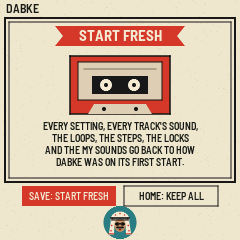

To go back to how DABKE was on its first start, hold SAVE while you switch the FM-1 on, and keep holding it until the START FRESH page shows. It says what goes: every setting, every track's sound, the loops, the steps, the locks and the MY SOUNDs. Let go of SAVE and press it again to start fresh: the screen says STARTED FRESH and DABKE opens on the home page with its first ready sound, Dabke Syria at 140, no loops, no steps of yours, no locks and no MY SOUNDs. It stays that way when you switch the FM-1 off and on.

To keep everything, press HOME, or any other button: the screen says EVERYTHING KEPT and the home page opens as on any start. The keys and the knobs do nothing on this page.

Starting fresh rewrites only DABKE's own saves, in the places DABKE always saves to. The panel's calibration and what other firmwares keep in the rest of the flash stay as they are.

---

## 16. The SOUND page

Press ENV. The SOUND page shapes one track's sound, and holds the arpeggio's controls. The title says whose sound it is:

- With a track picked that plays a lead sound, that track's, as in SOUND: TRACK 3.
- With ALL picked, track 1's. The title is SOUND.
- With a track picked that plays a drum, drone, left-hand or bass sound, track 1's, and the title says SOUND: TRACK 1. INSTRUMENT there changes track 1. It never turns the picked track into a lead sound: SELECT on the home page does that (see Any sound on any track).

VEL AMOUNT is shared by all the tracks, and so is the arpeggio on rows 5 and 6. The header shows the row, for example 1 / 6. Under the knobs, the sound's wave.

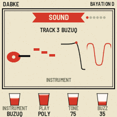

| Row | K1 | K2 | K3 | K4 |
| --- | --- | --- | --- | --- |
| 1 | INSTRUMENT | PLAY | TONE | BUZZ |
| 2 | PIPES APART | BREATH | BODY | DOUBLE |
| 3 | ATTACK | RELEASE | GLIDE | TRANSPOSE |
| 4 | TUNE | VEL AMOUNT | BEND RANGE | PICKING |
| 5 | ARP ORDER | ARP SPEED | ARP OVER | ARP LENGTH |
| 6 | ARP PATTERN | ARP REPEAT | ARP SWING | ARP LATCH |

| Knob | What it does |
| --- | --- |
| INSTRUMENT | The sound's instrument (see Sounds). Each comes with its own TONE, BUZZ, PIPES APART, BREATH, BODY, ATTACK, RELEASE, GLIDE and PLAY. |
| PLAY | LEGATO: one note at a time; a key pressed while another is held moves the note there without starting it again (the plucked instruments start again). MONO: one note at a time, each key starts it again. POLY: chords. |
| TONE | 0 to 100: darker to brighter. |
| BUZZ | 0 to 100: the reed's buzz. |
| PIPES APART | 0 to 40 cents: how far apart two pipes are tuned, for the beating of a mijwiz. |
| BREATH | 0 to 100: air in the sound. |
| BODY | 0 to 100: where the body's resonance sits, low to high. |
| DOUBLE | OFF, OCT DOWN, OCT UP: a second, softer note an octave down or up with each lead note. |
| ATTACK | 5 ms to 2.0 s. |
| RELEASE | 10 ms to 4.0 s. |
| GLIDE | 0 to 500 ms: how long each new lead note slides from the last one. |
| TRANSPOSE | -12 to +12 semitones, for this sound. Track 1's also moves the drone, the left hand and the bass line. The drums stay. |
| TUNE | -50 to +50 cents, for this sound. Track 1's also tunes the drone, the left hand and the bass line. |
| VEL AMOUNT | 0 to 100: how much the velocity changes the loudness. |
| BEND RANGE | 1/4 TONE, 1/2 TONE, 1 TONE, 1 1/2 TONE: how far key pressure and a MIDI pitch wheel bend this sound. Track 1's is also how far key pressure bends the left hand and the bass line. |
| PICKING | SINGLE or TREMOLO. With TREMOLO, a BUZUQ, OUD or QANUN sound is struck again and again while the key is held, at its ORN SPEED. |
| Rows 5 and 6 | The arpeggio (see The arpeggio). |

---

## 17. The ORNAMENTS page

Press LFO. The vibrato and the ornaments, the drone, and a few settings. Rows 1 and 2 edit the same track's sound as the SOUND page, and the title says whose, as in ORNAMENTS: TRACK 3 (see The SOUND page). PRESSURE, the drone and row 4 are shared by all the tracks.

| Row | K1 | K2 | K3 | K4 |
| --- | --- | --- | --- | --- |
| 1 | VIB SPEED | VIB DEPTH | VIB DELAY | ORNAMENT |
| 2 | ORN SPEED | HOW OFTEN | TRILL TO | PRESSURE |
| 3 | DRONE | SOUND | DRONE VOL | DRONE PITCH |
| 4 | HOME SCENE | (none) | USB PORT | KEY TOUCH |

| Knob | What it does |
| --- | --- |
| VIB SPEED | 2.0 to 9.0 Hz. |
| VIB DEPTH | 0 to 100. |
| VIB DELAY | 0 to 1.5 s: the sound's vibrato comes in after this long. The drone and the left hand get a lighter vibrato, from track 1's. |
| ORNAMENT | For lead sounds. OFF. MORDENT: a quick step up to the next note and back as each note starts. TURN: up, back, down, back. SCOOP: each note slides up into place. TRILL: the note and the next one in turn while the key is held. SHAKE: the pitch rocks up toward the next note and back while the key is held. AUTO, as DABKE starts: now and then, as HOW OFTEN says, a grace note, a scoop, a turn or two graces, and on some held notes a shake. |
| ORN SPEED | 4.0 to 24.0 Hz: how fast the ornaments move, and the TREMOLO picking. |
| HOW OFTEN | 0 to 100 %: how often AUTO ornaments a note. |
| TRILL TO | The neighbouring notes the ornaments go to: NEXT NOTE (the maqam's own neighbours, as tuned), 1/2 TONE or 1/4 TONE. |
| PRESSURE | NOTHING, BEND UP, BEND DOWN, VIBRATO, BRIGHTER (see Velocity and key pressure). |
| DRONE, SOUND, DRONE VOL, DRONE PITCH | The drone (see The drone). |
| HOME SCENE | PORTRAIT, STAGE, DANCERS, CASSETTE: the picture on the home page. |
| USB PORT | COMPUTER, as DABKE starts, or AUTO (see The Akai MIDImix). |
| KEY TOUCH | PLAIN or VELOCITY (see Velocity and key pressure). |

---

## 18. The EFFECTS page

Press FX. The effects, the picked track's controls, and the mixer, a track a row.

The effects, rows 1 to 3, work on the whole song and are the same whichever track is picked. A ready sound picked with ALL sets them. Picked on a track, it leaves them as they are.

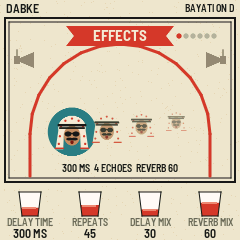

| Row | K1 | K2 | K3 | K4 |
| --- | --- | --- | --- | --- |
| 1 | DELAY | DELAY TIME | REPEATS | REVERB |
| 2 | DRIVE | CHORUS | WEDDING PA | BRIGHTNESS |
| 3 | WOBBLE | TAPE AGE | HISS | DELAY SYNC |
| 4 | TRACK | LENGTH | PITCH STEPS | DRUM |
| 5 | EFFECT | FADE | TOP SOUND | PITCH |
| 6 to 13 | VOLUME | FILTER | BASS | PART |

| Knob | What it does |
| --- | --- |
| DELAY | 0 to 100: the echo's level. |
| DELAY TIME | 60 to 700 ms. Changing it bends what is already in the echo, as a tape echo does. |
| REPEATS | 0 to 90. |
| REVERB | 0 to 100: a hall. Each track's EFFECT sets how much of it goes into the delay and the reverb. |
| DRIVE | 0 to 100: the lead, the drone and the left hand pushed into distortion. The bass and the drums stay clean. |
| CHORUS | 0 to 100, on the lead, the drone and the left hand. |
| WEDDING PA | 0 to 100: the whole sound through a wedding hall's PA, with no lows, a horn's honk, pushed hard, with the hall's slap-back. |
| BRIGHTNESS | 0 to 100: a filter on the whole sound. 100 is open. |
| WOBBLE | 0 to 100: the pitch wobbles, as on an old cassette. |
| TAPE AGE | 0 to 100: a worn tape, saturated, with fewer highs and lows. |
| HISS | 0 to 100: tape hiss. |
| DELAY SYNC | OWN TIME (DELAY TIME), or 1/8, 3/16, 1/4: the echo in time with the tempo. |
| TRACK | The picked track: ALL, or TRACK 1 to TRACK 8, as SEL picks it. |
| LENGTH | The picked track one bar or two long; a loop played live can also be as long as it was played. |
| PITCH STEPS | FULL: the pitch knobs move by semitones. MICRO: by quarter tones. |
| DRUM | The drum a tapped step gets on a drum track. On a note track: THE KEYS. |
| EFFECT | The picked track's share of the delay and the reverb, 0 to 100. |
| FADE | The scene fader, 0 to 100, TOP from 97 up (see The Akai MIDImix). |
| TOP SOUND | NONE, or TURN: CLEAR. Turn it to clear the top sound. |
| PITCH | The picked track's pitch, an octave down to an octave up, drums too. +1 1/4 means one and a quarter semitones up. |
| VOLUME | Rows 6 to 13, MIX: TRACK 1 to MIX: TRACK 8: that track's volume, 0 to 100. |
| FILTER | Left: DARK, a low-pass that closes down to 150 Hz. OPEN in the middle. Right: THIN, a high-pass that rises to 2.5 kHz. |
| BASS | LESS or MORE of the lows under 150 Hz, FLAT in the middle. |
| PART | ON or MUTED. Turn left to mute, right to switch it on. |

---

## 19. The RHYTHM page

Press GLO. The rhythm's feel, its added voices and fill-ins, the left hand, and the drum kit.

| Row | K1 | K2 | K3 | K4 |
| --- | --- | --- | --- | --- |
| 1 | SWING | ACCENT | VARIATION | LOOSENESS |
| 2 | ADD CLAPS | ADD RIQ | ADD SAGAT | ADD KICK |
| 3 | AUTO FILL | FILL IS | ADD RHYTHM | SYNC START |
| 4 | LEFT KEYS | BASS PLAYS | BACKING | CHORD TYPE |
| 5 | LEFT SOUND | BASS SOUND | BASS TONE | BASS DECAY |
| 6 | DRUM | DRUM LEVEL | DRUM TUNE | DRUM DECAY |
| 7 | KIT TUNE | KIT LENGTH | KIT TONE | LOW / HIGH |
| 8 | KICK | DARBUKA | CLAPS | RIQ, SAGAT |

| Knob | What it does |
| --- | --- |
| SWING | 0 to 100: every second step a little late. CHAABI 6/8 does not swing. |
| ACCENT | 0 to 100: how much louder the accented hits are. |
| VARIATION | PLAIN. BUSY: the ka fills every gap, the riq on every second step. HEAVY: the tabl and the kick double the dums, the tabl's stick and the claps double the teks. BY ITSELF: busy every fourth bar, heavy in the sixth of every eight. |
| LOOSENESS | 0 to 100: each hit a little louder or softer, at random. |
| ADD CLAPS | Claps with the teks. |
| ADD RIQ | The riq on the eighths. |
| ADD SAGAT | The sagat on every beat, and in most rhythms on the half beats too. |
| ADD KICK | A kick on every beat. |
| AUTO FILL | NEVER, 2 BARS, 4 BARS, 8 BARS, 16 BARS: a fill-in every that many bars. |
| FILL IS | ROLL: tek and ka in turn, louder and louder, a dum on each beat. BREAK: silence, then tek, slap, clap and stick together on the last step. STOPS: the band hits each beat together. |
| ADD RHYTHM | NONE, or a second rhythm playing along with the first. The bottom line shows both. |
| SYNC START | OFF or ON (see The left hand, bass and backing). |
| LEFT KEYS, BASS PLAYS, BACKING, CHORD TYPE | See The left hand, bass and backing. |
| LEFT SOUND | Track 3's sound: the lead's thirteen instruments. STRINGS as DABKE starts. |
| BASS SOUND | ROUND, SYNTH, BUZZ, WOODY, PICKED. |
| BASS TONE | 60 to 2500 Hz: how bright the bass is. |
| BASS DECAY | 30 % to 300 %: how long the bass note's pluck lasts. |
| DRUM | One of the thirteen drums for the next three knobs: DUM, TEK, KA, SLAP, TABL, STICK, RIQ, DAF, SAGAT, KICK, CLAP, SNARE, SHAKER. |
| DRUM LEVEL | 0 to 100. |
| DRUM TUNE | 25 % to 400 %. |
| DRUM DECAY | 20 % to 500 %. |
| KIT TUNE | 50 % to 200 %: every drum. |
| KIT LENGTH | 40 % to 250 %: every drum's decay. |
| KIT TONE | 0 to 100: the drums' highs. 100 is open. |
| LOW / HIGH | -100 to +100: the balance between the low drums (dum, tabl, daf, kick) and the others. Above 0 the low drums go down, below 0 the others. |
| Row 8 | KICK, DARBUKA, CLAPS and RIQ, SAGAT: the volumes of tracks 5 to 8, the same as their MIDImix faders. |

The rhythm's added voices, variations and fill-ins play only on the tracks that follow the rhythm, never on yours.

---

## 20. The Akai MIDImix

An Akai MIDImix on the FM-1's USB port works as DABKE's mixer: a strip for each track. Nothing on DABKE works only from the MIDImix. Every control has its place on the FM-1 too.

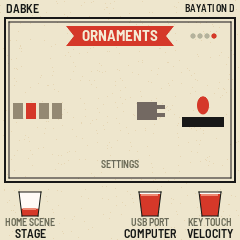

To use it, set USB PORT (the ORNAMENTS page, row 4, K3) to AUTO and plug the MIDImix into the FM-1's USB port. With AUTO and no computer on the port, the port looks for a controller in turns, from 30 seconds after the FM-1 starts. The screen says CONTROLLER READY when it finds one, and CONTROLLER UNPLUGGED when it goes. With COMPUTER, as DABKE starts, the port stays a computer's. In AUTO the port also takes another USB MIDI controller, such as a keyboard.

DABKE reads the MIDImix as it comes from the factory, on channel 1.

| MIDImix | What it does | On the FM-1 |
| --- | --- | --- |
| Strips 1 to 8 | Tracks 1 to 8. | The picked track (SEL) |
| Fader | The track's VOLUME. | K4 on the home page, or the EFFECTS page's MIX row, K1 |
| Top knob | The track's EFFECT, its share of the delay and reverb. | K1 on the home page |
| Middle knob | The track's FILTER. | K2 on the home page |
| Bottom knob | The track's PITCH: in tune in the middle, an octave down or up at the ends, in steps as PITCH STEPS says. | K3 on the home page |
| MUTE | The track off and on again. Lit while it is muted. | PART, the EFFECTS page's MIX row, K4 |
| REC ARM | REC for that track, and picks it. Let go, it records; again, it stops; held a second, its last take goes. Lit while it records or waits. | REC |
| SOLO | HOLD, as EDIT tapped. Lit while notes are held. | EDIT, tapped |
| BANK LEFT, BANK RIGHT | The rhythm before or after. Both together: the top sound cleared. | PRESET; TOP SOUND on the EFFECTS page, row 5, K3 |
| Master fader | The scene fader. | FADE, the EFFECTS page, row 5, K2 |

A fader or a knob moves its own strip's track and never picks it: the keys stay where they are while you ride another track. The screen says what moved, for example TRACK 6: VOLUME 70. The SEND ALL button sends every value at once: DABKE takes them all and says nothing. No light blinks: each one shows what its label says.

In step mode, with a step held, a strip's knob or fader is locked on that step. While a track records, its knobs are kept as locks on the steps the recording passes. Its fader is not.

### The scene fader

The master fader, or FADE on the FM-1, moves between two settings of the strips: the sound as set, and a top sound. Each track's EFFECT, FILTER, PITCH and VOLUME can have a top value.

1. Push the fader to its top, the last 3 % (FADE 97 and up). The screen says FADER UP: THIS IS THE TOP SOUND.
2. Move the strips you want to change: you set their top values.
3. Pull the fader down: the sound as set (FADER DOWN: THE SOUND AS SET). In between, those controls move from their set values toward their top values.

Both BANK buttons together, or turning TOP SOUND on the EFFECTS page, clears the top sound. The top sound is kept with the settings. The fader's place is not: DABKE starts with it down.

---

## 21. MIDI and USB audio

On a computer, the FM-1 shows up as DABKE FM-1. DABKE has no Bluetooth.

MIDI comes in over USB and the FM-1's TRS MIDI jack. Notes on any channel play the picked track, as the keys would. With ALL picked and LEFT KEYS on SPLIT or BASS, notes under C4 go to the left hand. Notes under E1 do not play: on channel 1 they are the MIDImix's buttons. A pitch wheel bends the lead sounds, each by its own BEND RANGE, and a mod wheel adds vibrato. Notes from MIDI get the maqam's quarter tones too.

The MIDImix's messages work from any MIDI input on channel 1, so a computer can send them: the strips' knobs and faders as control changes 16 to 31 and 46 to 61, the master fader as 62, and the buttons as notes 1 to 27.

MIDI goes out over USB: the keys' notes on channel 1, with the velocity they were played at and the octave. Drum keys and the steps in step mode send nothing, and the pressure is not sent. DABKE keeps its own tempo: it does not follow MIDI clock and does not send it.

Over the USB cable the FM-1 is also a sound card. Your computer can record DABKE from the input named DABKE FM-1. It records DABKE alone, at MASTER's volume, never what the computer plays. The computer can also play through the FM-1: choose DABKE FM-1 as its output, and you hear it from the FM-1's speaker and headphones, mixed with DABKE, at MASTER's volume.

---

## 22. Troubleshooting

**No sound.** Turn MASTER up. With ALL picked, K1 to K4 on the home page are the volumes of the lead, the drone, the left hand and the drums. A muted track's lane is dimmed: switch it on with PART on its MIX row of the EFFECTS page, or MUTE on the MIDImix.

**A key does not bend.** Only F3 to C5 sense pressure: the top seven keys, C#5 to G5, do not. Check that PRESSURE is not on NOTHING (the ORNAMENTS page, row 2, K4). Drum tracks have no pressure, a loop playing back does not bend, and the drone does not bend. BRIGHTER does not change ORGAN, BUZUQ, OUD, QANUN or the bass sounds.

**The drone is silent.** Check DRONE and DRONE VOL (the ORNAMENTS page, row 3). The drone sounds only while you play the lead, the rhythm runs, the left hand holds a chord, or you play its track.

**A left key does not start the rhythm.** SYNC START needs ALL picked and LEFT KEYS on SPLIT or BASS.

**The MIDImix does nothing.** Set USB PORT to AUTO. With a computer on the port, the port stays the computer's. After the FM-1 starts, the port looks for a controller only after 30 seconds. Wait for CONTROLLER READY.

**My changes were not kept.** DABKE saves only with the rhythm stopped and the sound quiet. Stop the rhythm and wait a few seconds before you switch the FM-1 off.

**DABKE started fresh.** Another firmware installed since may have written over DABKE's saves (see Install).

**Notes stop early.** DABKE plays up to 16 notes at once besides the drone, and fewer when the FM-1 is busy. The oldest note stops first.

**NO ROOM FOR MORE NOTES, NO ROOM FOR MORE LOCKS.** A track holds 128 notes, all the tracks 512, and all the locks 240. Take back a take, or remove some steps or locks.

**CANNOT BE LOCKED TO A STEP.** That control cannot hold a value of its own on a step. The tempo, the rhythm, choices such as ORNAMENT, a mute and FADE are among them.

**The installer does not find the FM-1.** Use Chrome or Edge, and allow MIDI when the browser asks. Close other programs that use the FM-1's MIDI port.

**DABKE SAFE MODE on the screen.** DABKE failed twice while starting. There is no sound, but USB works: install DABKE again from the web installer. PLAY tries starting DABKE again. REC puts the FM-1 in the chip's own update mode.

---

## 23. Credits

DABKE is made by STUDIOMORPHIK and built on fm1-base by Charles Vestal and felucca-bsp, from Felucca by Leo Kuroshita (Hügelton Instruments). Licence MPL-2.0. Source at [github.com/wissamsader/dabke](https://github.com/wissamsader/dabke).
