# DABKE

DABKE is a free firmware for the M-VAVE FM-1 that makes it an Arabic wedding keyboard. It has lead voices with quarter tones on any note, a drone, bass and backing from the left hand, and a rhythm box of darbuka, tabl, riq, daf, sagat, kick and claps. Eight tracks loop or freeze what you play, and an Akai MIDImix can work as its mixer.

**Status.** This is version 0.20, a free public beta from STUDIOMORPHIK. It has been tested on one FM-1.

**New in 0.20.** New jobs for the buttons and the MIDImix: REC freezes the picked track, SEQ records its loop, and EDIT held a second is step mode. There is a MIXER and a MASTER EQ, and the screen has a new look. If you played 0.19, read What changed in 0.20, below, first.

**New in 0.18.** Hold SAVE while you switch the FM-1 on to start fresh: every setting, sound, loop, step, lock and MY SOUND goes back to how DABKE was on its first start (see Saving). The MAQAM page marks every note of the maqam, on the black keys as on the white ones.

**New in 0.17.** Each of the eight tracks keeps its own sound, so SAZ on track 2 and BUZUQ TREMOLO on track 3 play at the same time. SELECT on a picked track offers the 22 ready sounds and your MY SOUNDs, and the SOUND and ORNAMENTS pages edit the picked track's sound. The effects, the tempo, the maqam and the rhythm are still shared by the whole song. Saves from 0.16 load and sound as they did.

---

## What changed in 0.20

DABKE's sounds, maqamat, rhythms, step sequencer and singer are as they were. The buttons, the pages' rows and the MIDImix have new jobs, each track has a reverb send of its own, and there is a MIXER and a MASTER EQ. The screen has a new look, ink and red on paper. Everything 0.19 saved loads whole (see Saving).

| In 0.19 | In 0.20 |
| --- | --- |
| ALL, or one of the eight tracks, picked | Always one of the eight. Track 1 plays the keys as ALL did, with LEFT KEYS, and a ready sound or a MY SOUND picked on it brings its effects, as with ALL. A 0.19 save with ALL picked opens on track 1 |
| SEL tapped: the next track. SEL held with a white key: that track, on the home page | SEL held with a white key picks a track on every page, and the ninth white key picks the background. SEL tapped opens the MAQAM page |
| REC: the picked track recorded live. Held a second: the last take gone | SEQ: the picked track's loop. Tapped, it records, closes and plays, stops, plays again. Held a second: cleared |
| REC on a track with a loop recorded over it | Gone. SEQ on a loop stops it or plays it again |
| EDIT tapped, or the MIDImix's SOLO: HOLD | REC freezes the picked track, and the MIDImix's REC ARM its strip's track |
| SEQ tapped: step mode. SEQ held a second: every recording cleared. EDIT held a second in step mode: the track's locks gone | EDIT held a second: step mode on or off. SEQ held a second clears one track's loop, with its locks |
| PLAY: the rhythm on or off | PLAY stops everything that sounds and brings it back; with nothing to bring back, it starts the rhythm. Held 0.4 s while the rhythm runs: a fill-in, as before |
| The home page's K1 to K4: EFFECT, FILTER, PITCH, VOLUME | PITCH, FILTER, SPACE, LEVEL. HOME again: two more rows |
| One EFFECT a track, its share of the delay and the reverb | A DELAY SEND and a REVERB SEND a track. SPACE turns both |
| The EFFECTS page, rows 4 and 5: TRACK, LENGTH, PITCH STEPS, DRUM; EFFECT, FADE, TOP SOUND, PITCH | The EDIT page's STEPS and SCENE rows. The EFFECTS page's rows 4 and 5 are the picked track's SENDS and TONE, and row 6 is a new MASTER EQ. FX held a second resets the row shown |
| The EFFECTS page's eight MIX rows | The MIXER, the EDIT page's last row: LEVEL, FX, MUTE, SOLO |
| The maqam page: K1 CENTS, K2 MAQAM, K3 ROOT, K4 DEPTH, SELECT the note | Two rows: MAQAM, ROOT, DEPTH, PITCH STEPS, and NOTE, ITS CENTS, KEY TOUCH, USB PORT. SELECT turns the maqam |
| SELECT on the RHYTHM page: the rows | The rhythm, as PRESET |
| The MIDImix: top knob EFFECT, bottom knob PITCH, SOLO HOLD, REC ARM recorded, BANK the rhythms, master fader the scene | Top knob PITCH, bottom knob SPACE, SOLO the knobs' EFFECTS layer, REC ARM freezes, BANK the picked track's sound, master fader the whole level. The scene fader is FADE, on the EDIT page |
| SAVE on a used place replaced it | SAVE asks first, and SAVE again replaces it |
| The screen: light words on black, the knobs as bars | Ink and red on paper. Each page sits in a frame with its name on a red ribbon and a dot a row, and the four knobs are glasses that fill up. The singer and his scenes are as they were |

---

## Contents

1. Install
2. The panel
3. The home page
4. The eight tracks
5. Sounds
6. Maqam and quarter tones
7. Rhythms and tempo
8. The left hand, bass and backing
9. The drone
10. Velocity and key pressure
11. Loops (SEQ)
12. Steps and locks
13. Freezing (REC)
14. PLAY
15. The arpeggio
16. Saving
17. The SOUND page
18. The ORNAMENTS page
19. The EFFECTS page
20. The RHYTHM page
21. The EDIT page and the MIXER
22. The Akai MIDImix
23. MIDI and USB audio
24. Troubleshooting
25. Credits

---

## 1. Install

DABKE installs from the browser, with Chrome or Edge on a computer. Connect the FM-1 by USB, open the [DABKE installer](https://studiomorphik.com/dabke/install/) and follow its steps. The browser asks once to allow MIDI: allow it. Keep the cable in while it writes.

You can also install DABKE with any FM-1 installer that takes a `.fwsc` package. To try DABKE first, the site's Emulator page runs it in your browser.

To go back to another firmware, install that one the same way. When an installer starts writing over USB while DABKE runs, DABKE first saves anything it had not saved yet. When you install DABKE again, it goes on where you left it: its saves stay in the flash, unless the other firmware wrote over them (see below). To begin again from DABKE's first start instead, hold SAVE while you switch the FM-1 on (see Start fresh, in Saving).

DABKE 0.20 loads what 0.19 saved, whole (see Saving). DABKE 0.17 loads what 0.16 saved, and it sounds as it did. Going back to 0.16 after 0.17 has saved starts 0.16's settings fresh. The kept sounds stay.

> Some other FM-1 firmwares keep their saves in the same part of the flash as DABKE. After you install one of them, DABKE can start fresh when you come back to it, as on its first start.

---

## 2. The panel

| Control | What it does in DABKE |
| --- | --- |
| Keys | The 27 keys, F3 to G5, play the picked track (see The eight tracks). With track 1 picked, the twelve lowest play as LEFT KEYS sets them, outside step mode. In step mode the white keys are the steps. |
| HOME | The home page (in step mode, the step view). Again: its next row of four knobs. |
| SEL, tapped | The MAQAM page, from any page. On it, SEL again: its next row. |
| SEL, held | With one of the first eight white keys, F3 to F4: that track is picked, on any page. With the ninth, G4, or any above it: the background, for the EFFECTS page and the MIXER. The key plays nothing. |
| ENV | The SOUND page. Again: its next row. |
| LFO | The ORNAMENTS page. Again: its next row. |
| GLO | The RHYTHM page. Again: its next row. |
| FX, tapped | The EFFECTS page. On it, FX again: its next row, when you let go. |
| FX, held a second | On the EFFECTS page: the row shown goes back to its start values. |
| EDIT, tapped | The EDIT page: the steps' settings, the scene and the MIXER. Again: its next row. |
| EDIT, held a second | Step mode on or off: the white keys are the picked track's steps. |
| EDIT, with a key | Hold EDIT and press a key: that note a quarter tone flat, or back. In step mode, EDIT with a step held: that step's locks go. |
| REC | Freezes the picked track: its notes sound on without the keys. Again: they are let go (see Freezing). |
| SEQ, tapped | The picked track's loop: it records, closes and plays, stops, plays again (see Loops). |
| SEQ, held a second | The picked track's loop cleared. |
| PLAY | Stops everything that sounds. Again: it all comes back. With nothing to bring back: the rhythm starts. While the rhythm runs, held 0.4 s: a fill-in (see PLAY). |
| ARP | Tap it: the arpeggio on or off. Hold it: the arpeggio's panel. |
| SAVE | KEEP THE SOUND: keeps a track's sound in one of eight places (see Saving). |
| SELECT | On the home page: the picked track's sound. On the RHYTHM page: the rhythm. On the MAQAM page: the maqam, or on its TUNING row the note to tune. On the save page: the place. On any other page: the rows. |
| PRESET | The rhythm. |
| ALGO | The tempo, 2 beats a minute a click. |
| OCT- · OCT+ | The octave, from -3 to +3. In step mode: the page of steps before or after. |
| K1 to K4 | The four knobs of the row shown. |
| MASTER | The volume. |

The button of the page you are on is lit. PLAY is green while anything sounds. REC is lit while the picked track is frozen. SEQ is lit while the picked track's loop records, and at a second level while it plays. ARP is lit while the arpeggio is on. EDIT is lit while you hold it, and at a second level in step mode.

After most actions, a short message takes the place of the top line for a moment, for example TRACK 3: LEFT HAND STRINGS.

---

## 3. The home page

The home page shows the singer over the eight tracks. Its four knobs work on the picked track, in three rows. K1 to K4 turn the row shown. HOME again shows the next row, and the screen says which, as in HOME: MIX.

| Row | K1 | K2 | K3 | K4 |
| --- | --- | --- | --- | --- |
| 1 TRACK | PITCH | FILTER | SPACE | LEVEL |
| 2 MIX | DELAY SEND | REVERB SEND | BASS | SOUND |
| 3 PLAYING | HOW OFTEN | VIB DEPTH | GLIDE | ORNAMENT |

Row 1 is the picked track's strip as the MIDImix has it: its top knob, middle knob, bottom knob and fader.

| Knob | What it does |
| --- | --- |
| PITCH | The track's pitch, an octave down to an octave up, drums too. PITCH STEPS says whether it moves by semitones or quarter tones. +1 1/4 means one and a quarter semitones up. |
| FILTER | Left: DARK, a low-pass that closes down to 150 Hz. OPEN in the middle. Right: THIN, a high-pass that rises to 2.5 kHz. |
| SPACE | DELAY SEND and REVERB SEND together, each moved by as much. It shows their middle. |
| LEVEL | The track's volume, 0 to 100. Track 2's is DRONE VOL. |
| DELAY SEND | How much of the track goes into the delay, 0 to 100. |
| REVERB SEND | How much of the track goes into the reverb, 0 to 100. |
| BASS | LESS or MORE of the lows under 150 Hz, FLAT in the middle. |
| SOUND | The track's sound, as SELECT on the home page turns it. |
| HOW OFTEN, VIB DEPTH, GLIDE, ORNAMENT | The same knobs as on the SOUND and ORNAMENTS pages, for the sound those pages show (see The SOUND page). |

In step mode HOME shows the step view instead, with the row shown on K1 to K4 (see Steps and locks).

| Part | What it shows |
| --- | --- |
| Top line | The picked track's number and sound, as in 3 LEFT HAND STRINGS, and ARP while the arpeggio is on. At the right, the maqam on its root, as in BAYATI ON D. A message takes its place for a moment, in red. |
| The singer | The singer claps on the beat and dances while the rhythm runs. HOME SCENE on the ORNAMENTS page picks the picture. |
| Lanes | The eight tracks, a lane each, numbered 1 to 8. A number on red is the picked track, a red number is a track recording its loop. A short bar by the number: the track plays something of yours. Along the lane, the track's steps: a dark block where something of yours begins, a low grey block where the rhythm plays, a blue line for a lock, red for the step playing now. The number at the right is the track's length in steps. A muted track is dimmed. |
| Bottom line | The rhythm, and the one added to it, grey while the rhythm is stopped. Three dots for the home page's rows, the one shown in red. At the right, the tempo, with a metronome that swings on the beats while the rhythm runs. |
| Glasses | K1 to K4: the row shown. Each knob is a glass, filled as far as it is turned, with its name and value under it. |

HOME SCENE (the ORNAMENTS page, row 4, K1) has four pictures: PORTRAIT, STAGE (as DABKE starts), DANCERS and CASSETTE.

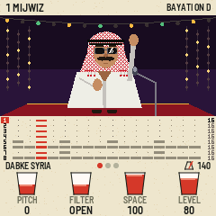
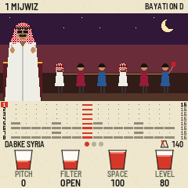
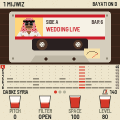

---

## 4. The eight tracks

| Track | As DABKE starts |
| --- | --- |
| 1 | LEAD: the lead instrument, MIJWIZ. |
| 2 | DRONE: the drone. |
| 3 | LEFT HAND: the left hand's own sound and the backing chords, STRINGS. |
| 4 | BASS LINE: the bass. |
| 5 | KICK. |
| 6 | DARBUKA, TABL: dum, tek, ka, slap, tabl, stick and daf. |
| 7 | CLAPS: claps and snare. |
| 8 | RIQ, SAGAT: riq, sagat and shaker. |

### Picking a track

One of the eight tracks is always picked: DABKE starts on track 1. To pick another, hold SEL and press one of the first eight white keys, F3 for track 1 up to F4 for track 8. This works on any page, and the key plays nothing. While SEL is held those eight keys light up, the picked one brightest. The screen says the track and its sound, for example TRACK 4: ROUND. TRACK on the EDIT page (row 1, K1) picks a track too.

Tapped alone, SEL opens the MAQAM page (see Maqam and quarter tones).

### The background

Hold SEL and press the ninth white key, G4, or any white key above it: the background is picked (BACKGROUND PICKED: ON FX AND THE MIXER). The background is the rhythm's drums: every track with a drum sound. The EFFECTS page's SENDS and TONE rows and the MIXER then work on it (see The EFFECTS page, and The EDIT page and the MIXER). The keys still play the picked track. Hold SEL and press a track's key to give the rows back to that track. While SEL is held the ninth key is lit too, brighter while the background is picked.

### What the keys play

The keys play the picked track over the whole keyboard, whether the rhythm runs or not. A note sound plays notes. A drum sound plays its drums in turn up the keys: the kick on every key, or on track 6 dum, tek, ka, slap, tabl, stick and daf, then dum again.

Track 1 plays the keys as LEFT KEYS sets them (the RHYTHM page, row 4, K1):

- SAME: the whole keyboard plays track 1, the lead.
- SPLIT: the twelve lowest keys, F3 to E4, play the left hand's own sound (track 3), the rest track 1.
- BASS: the twelve lowest keys give the bass and the backing their chord, the rest play track 1.

With SPLIT or BASS, those twelve keys are lit dim. In step mode LEFT KEYS does not split the keys: every key is the picked track's, track 1's too. Any other track picked: every key plays that track.

### Any sound on any track

Turn SELECT on the home page to change the picked track's sound. SOUND, K4 of the home page's MIX row, does the same, and so do BANK LEFT and BANK RIGHT on the MIDImix. It goes through the track's own family first, then the others in this order: LEAD, DRONE, LEFT HAND, BASS, KICK, DARBUKA, CLAPS, RIQ. LEAD's sounds are the 22 ready sounds, then the MY SOUNDs you kept (see Sounds). On track 1 a lead sound brings its effects too. A note sound makes the track a track of notes: its keys play notes and it records loops. A drum sound makes it a drum track: its keys play drums and it records steps.

Each track keeps its own sound. SAZ on track 2 and BUZUQ TREMOLO on track 3 play at the same time, each with its own settings. The screen names a lead sound by its own name, as in TRACK 2: SAZ. A sound of another family whose name is shared gets its family in front, as in TRACK 2: DRONE ORGAN.

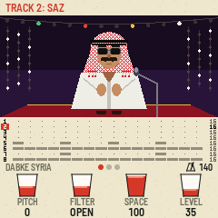

### Yours and the rhythm's

The rhythm plays tracks 5 to 8, and with LEFT KEYS on BASS also the bass line (track 4) and the backing (track 3). Once you record, write or remove anything on one of those tracks, it is yours: the rhythm, its variations, its added voices and its fill-ins leave it alone. Cleared with SEQ held a second, it follows the rhythm again.

---

## 5. Sounds

The ready sounds are MIJWIZ, MIJWIZ BUZZ, ZURNA, KEY LEAD, FAST LEAD, WHISTLE LEAD, SQUARE LEAD, VIOLIN, STRINGS, NEY, ACCORDION, ORGAN, BUZUQ, BUZUQ TREMOLO, SAZ, OUD, QANUN, QANUN TREMOLO, BRASS, WEDDING ZURNA, CASSETTE MIJWIZ and SHAABI LEAD. After them come the sounds you kept, MY SOUND 1 to MY SOUND 8. SELECT on the home page goes through them on the picked track: they are its LEAD sounds (see Any sound on any track).

Each track keeps its own full sound: its instrument, the SOUND page's knobs (apart from VEL AMOUNT and the arpeggio), the vibrato and the ornaments. A track's LEVEL, sends, FILTER, BASS, PITCH and MUTE are its own too, and stay when its sound changes. The effects (the EFFECTS page's first three rows and the MASTER EQ), the tempo, the maqam, the rhythm, KEY TOUCH, PRESSURE, VEL AMOUNT and the arpeggio are shared by all the tracks.

On track 1, a ready sound or a MY SOUND also sets the effects on the EFFECTS page's first three rows, as ALL did in 0.19: WEDDING ZURNA brings its PA and drive, CASSETTE MIJWIZ its tape wobble, age and hiss. On any other track it sets that track's sound alone and never the effects, because the effects work on the whole song. Picking a sound never changes another track's sound. The drone, the levels, the rhythm, the arpeggio and the maqam stay as they are.

### The lead's instruments

INSTRUMENT on the SOUND page (row 1, K1) is the instrument of the sound the page shows (see The SOUND page). Each ready sound is built on one of them: BUZUQ TREMOLO and SAZ on BUZUQ, for example. There are thirteen:

| Instrument | What it is |
| --- | --- |
| MIJWIZ | Two reed pipes tuned a little apart, with their beating, a nasal body and a buzz. |
| ZURNA | A double reed through a narrow bell: loud and nasal. |
| KEY LEAD | The keyboard lead: two saw waves through a resonant filter. |
| VIOLIN | A bowed string. |
| NEY | A pure tone with breath tuned to the note. |
| ACCORDION | Reeds. |
| STRINGS | A string section, slow to start. |
| ORGAN | An organ. |
| BUZUQ, OUD, QANUN | Plucked strings. |
| BRASS | Brass, its filter opening as each note starts. |
| SQUARE | A square-wave lead. |

Each instrument brings its own TONE, BUZZ, PIPES APART, BREATH, BODY, ATTACK, RELEASE, GLIDE and PLAY. The SOUND page shapes one track's sound at a time (see The SOUND page). The left hand and the drone play their instruments with their own settings, and follow track 1's TRANSPOSE, TUNE and vibrato.

### Every family's sounds

| Family | Sounds |
| --- | --- |
| LEAD | The 22 ready sounds, then the MY SOUNDs you kept |
| LEFT HAND | MIJWIZ, ZURNA, KEY LEAD, VIOLIN, NEY, ACCORDION, STRINGS, ORGAN, BUZUQ, OUD, QANUN, BRASS, SQUARE |
| DRONE | MIJWIZ, ORGAN, STRINGS, ACCORDION, NEY, VIOLIN, BRASS |
| BASS | ROUND, SYNTH, BUZZ, WOODY, PICKED |
| KICK | MACHINE, BOOM, TIGHT, THUMP |
| DARBUKA | CLAY, DEEP, BRIGHT, METAL |
| CLAPS | HANDS, CROWD, SNAPS, ROOM |
| RIQ | BRASS, BRIGHT, DARK, LONG |

DABKE plays up to 16 notes at once, the drone apart. When the FM-1 is busy it plays fewer, and the oldest note stops for the newest.

---

## 6. Maqam and quarter tones

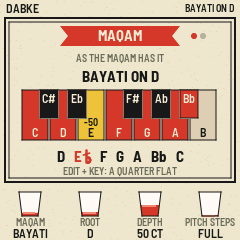

Tap SEL on any page to open the MAQAM page at its first row. SEL again shows its other row. The page shows the twelve notes of an octave, C to B, as a keyboard. Every note of the maqam is red, on the black keys as on the white ones, and every note outside it keeps its plain colour. The black keys are the short, narrow ones between the white keys. A retuned note is yellow, with its cents. A thicker frame marks the note the TUNING row tunes. Under the keys, the maqam's scale is written out, with a half-flat sign on each quarter-tone note.

| Row | K1 | K2 | K3 | K4 |
| --- | --- | --- | --- | --- |
| 1 MAQAM | MAQAM | ROOT | DEPTH | PITCH STEPS |
| 2 TUNING | NOTE | ITS CENTS | KEY TOUCH | USB PORT |

| Control | What it does |
| --- | --- |
| SELECT | On the MAQAM row: the maqam. On the TUNING row: the note to tune, as NOTE. |
| MAQAM | The maqam. Each comes on its usual root, with its notes tuned. |
| ROOT | Moves the maqam to another root. |
| DEPTH | How flat a quarter tone flat is: 20 to 80 cents, 50 as DABKE starts. |
| PITCH STEPS | FULL or MICRO: how the tracks' PITCH knobs move (see The EDIT page and the MIXER). |
| NOTE | The note to tune, C to B: the key with the thicker frame. |
| ITS CENTS | That note's tuning, from -100 to +100 cents. |
| KEY TOUCH, USB PORT | The same as on the ORNAMENTS page, row 4. |

DABKE starts on BAYATI ON D. The maqamat, on their usual roots:

| Maqam | Root | Its notes |
| --- | --- | --- |
| PLAIN | C | C, D, E, F, G, A, B. No quarter tones. |
| RAST | C | C, D, E half flat, F, G, A, B half flat |
| BAYATI | D | D, E half flat, F, G, A, Bb, C |
| SABA | D | D, E half flat, F, F#, A, Bb, C |
| SIKAH | E half flat | E half flat, F, G, A, B half flat, C, D |
| HUZAM | E half flat | E half flat, F, G, Ab, B, C, D |
| IRAQ | B half flat | B half flat, C, D, E half flat, F, G, A |
| BAYATI SHURI | D | D, E half flat, F, G, Ab, B, C |
| HIJAZ | D | D, Eb, F#, G, A, Bb, C |
| HIJAZ KAR | C | C, C#, E, F, G, Ab, B |
| KURD | D | D, Eb, F, G, A, Bb, C |
| NAHAWAND | C | C, D, Eb, F, G, Ab, B |
| AJAM | Bb | Bb, C, D, Eb, F, G, A |
| NAKRIZ | C | C, D, Eb, F#, G, A, Bb |
| SABA ZAMZAM | D | D, Eb, F, F#, A, Bb, C |

### A quarter tone on any note

Hold EDIT and press a key: that note goes a quarter tone flat, in every octave. Press it again with EDIT held: it is back. This works on every page. While EDIT is held, the keys tuned flat are lit dim. In step mode the white keys are steps, so there EDIT and a white key removes that step's locks, and the black keys still tune. For any other amount, use NOTE and ITS CENTS on the MAQAM page's TUNING row.

Once a note is tuned by hand, the MAQAM page says CHANGED BY HAND. Choosing a maqam or a root again tunes the notes as the maqam has them.

The tuning goes to every track's notes, the drone, the arpeggio and notes coming in over MIDI.

---

## 7. Rhythms and tempo

Turn PRESET to change the rhythm, or SELECT on the RHYTHM page. With the rhythm stopped, the tempo goes to the new rhythm's own. While it runs, the tempo stays. Turn ALGO for the tempo, from 40 to 240.

| Rhythm | Group | Its tempo |
| --- | --- | --- |
| DABKE SYRIA | Levant | 140 |
| DABKE LEBANON | Levant | 116 |
| DABKE 3-3-2 | Levant | 132 |
| TABL ZURNA | Levant | 120 |
| MAQSUM | Egypt | 100 |
| BALADI | Egypt | 96 |
| SAIDI | Egypt | 112 |
| WAHDA | Egypt | 84 |
| MALFUF | Egypt | 120 |
| AYOUB | Egypt | 116 |
| FALLAHI | Egypt | 132 |
| KARACHI | Egypt | 116 |
| ZAFFA | Egypt | 100 |
| SHAABI | Egypt | 112 |
| MAHRAGAN | Egypt | 128 |
| KHALIJI | Gulf | 88 |
| CHOBI | Iraq | 138 |
| CHAABI 6/8 | Maghreb | 104 |
| SAMAI 10/8 | Classic | 80 |
| LAZ 7/8 | Classic | 100 |
| MASMUDI 8/4 | Classic | 92 |

Each rhythm has its own bass line and backing pattern for the left hand.

PLAY starts the rhythm, and every track's loop and steps play with it. PLAY again stops everything, and the next PLAY brings it back (see PLAY). While the rhythm runs, hold PLAY for 0.4 s: a fill-in plays in the last two beats of the bar (FILL IN), and the rhythm goes on.

The RHYTHM page has the rest: swing, accents, variations, added claps, riq, sagat and kick, automatic fill-ins, a second rhythm on top, SYNC START and the drum kit (see The RHYTHM page).

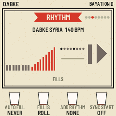

### Your own rhythm

Make a rhythm your own by writing or recording on the drum tracks, 5 to 8, in step mode or live with SEQ (see Loops, and Steps and locks). Each track you change is yours and the others go on following the rhythm. Change the rhythm with PRESET and your tracks stay as you made them, while the untouched ones follow the new rhythm.

---

## 8. The left hand, bass and backing

These work with track 1 picked, outside step mode, as LEFT KEYS sets the twelve lowest keys (F3 to E4).

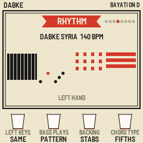

With LEFT KEYS on SPLIT, the left keys play track 3's sound (LEFT SOUND, the RHYTHM page, row 5, K1). They stay at their own pitch whatever the octave.

With LEFT KEYS on BASS, hold a left key: its note is the chord's root (with several held, the lowest). With the rhythm stopped, the bass and the chord sound while you hold it. With the rhythm running, the bass line (track 4) and the backing (track 3) play on that root, as BASS PLAYS and BACKING say, and go on with it after you let go, until you hold another left key.

| Knob | Choices |
| --- | --- |
| BASS PLAYS | PATTERN: the rhythm's bass line. ROOT: the root on the rhythm's bass hits. OCTAVES: the root and its octave in turn. WALKING: up and down the maqam, a note a beat. NONE. |
| BACKING | STABS: short chords on the rhythm's backing hits. HELD: the chord held. ARPEGGIO: the maqam's notes in turn, eighths. NONE. |
| CHORD TYPE | FIFTHS: root, fifth and octave. MAQAM: the root with the maqam's third and fifth. |

LEFT SOUND, BASS SOUND, BASS TONE and BASS DECAY are on row 5. The left hand's volume is track 3's LEVEL and the bass line's is track 4's: their MIDImix faders, or LEVEL with that track picked.

Record or write something on track 3 or 4 and it is yours: the automatic backing or bass line on that track goes silent until you clear it.

### SYNC START

With SYNC START on (the RHYTHM page, row 3, K4), the first left key starts the rhythm. It needs track 1 picked and LEFT KEYS on SPLIT or BASS.

---

## 9. The drone

The drone holds the maqam's tonic, tuned as the maqam has it. It sounds while you play the lead (and 0.6 s after), while the rhythm runs, while the left hand holds a chord, and while you play its own track, even with DRONE on OFF. Its controls are on the ORNAMENTS page, row 3, the same whichever track is picked:

| Knob | What it does |
| --- | --- |
| DRONE | OFF, TONIC (as DABKE starts), TONIC + 5TH, or LEFT KEY: the root of the left hand's chord while you hold one (LEFT KEYS on BASS), the tonic otherwise. |
| SOUND | MIJWIZ, ORGAN, STRINGS, ACCORDION, NEY, VIOLIN, BRASS. |
| DRONE VOL | 0 to 100. Turned up while the drone is OFF, it switches the drone on, on the tonic. |
| DRONE PITCH | LOW (C2 to B2) or MIDDLE (an octave up). |

DRONE VOL is also track 2's LEVEL: its MIDImix fader, or LEVEL with track 2 picked. A ready sound leaves the drone as it is. Track 1's TRANSPOSE, TUNE and vibrato move the drone too.

The drone is track 2. With it picked, a key moves the drone to that note, in the drone's own octave. It goes back to the tonic when the rhythm starts or stops. Record a loop on track 2 with SEQ and the drone moves with the loop. Starting a loop on track 2 with DRONE on OFF switches the drone on, on the tonic. With the drone's track picked, the SOUND and ORNAMENTS pages edit track 1's sound (see The SOUND page).

---

## 10. Velocity and key pressure

### Velocity

KEY TOUCH (the ORNAMENTS page, row 4, K4, or the MAQAM page's TUNING row, K3) has two choices. VELOCITY, as DABKE starts: each note lands as hard as you play it, on all 27 keys. PLAIN: every note lands the same, at 100. KEY TOUCH sets only how hard a note lands. VEL AMOUNT (the SOUND page, row 4, K2) sets how much that changes the loudness: at 0, every note is equally loud. Both are shared by all the tracks.

### Pressure

Press harder on a key you hold, and PRESSURE (the ORNAMENTS page, row 2, K4) says what happens. It works by itself, whatever KEY TOUCH says, and it is the same for every track.

| PRESSURE | What a harder press does |
| --- | --- |
| NOTHING | Nothing. |
| BEND UP | Bends the note up, by BEND RANGE at full pressure. As DABKE starts. |
| BEND DOWN | Bends the note down, by BEND RANGE at full pressure. |
| VIBRATO | A vibrato that deepens as you press, at VIB SPEED. |
| BRIGHTER | Opens the sound's tone. |

BEND RANGE is part of each track's sound, on the SOUND page, row 4, K3: 1/4 TONE, 1/2 TONE (as DABKE starts), 1 TONE or 1 1/2 TONE. A lead sound bends by its own BEND RANGE, the left hand and the bass line by track 1's.

Only the 20 lowest keys sense pressure: F3 to C5. The top seven keys, C#5 to G5, sense velocity but not pressure.

The pressure goes to the notes the keys are playing, on whichever track that is: the lead, the left hand, the bass line, any note sound. With track 1 picked and LEFT KEYS on SPLIT or BASS, each key's pressure goes to its own track. A light touch does nothing, so a resting finger does not bend. Drum keys have no pressure. The pressure does not move a loop's notes as they play back, and it is not recorded. It does not bend the drone. BRIGHTER changes every instrument but ORGAN, BUZUQ, OUD and QANUN, and it does not change the bass sounds.

With KEY TOUCH on PLAIN and PRESSURE on NOTHING, the keys work as plain switches.

---

## 11. Loops (SEQ)

SEQ is the picked track's loop. A track with a note sound records a loop of what you play on it. A drum track records hits on its steps.

1. Pick the track: hold SEL and press its white key.
2. Tap SEQ. If the rhythm runs, the track records at once (TRACK 1 LOOP RECORDING). If not, it waits for your first key, which starts the rhythm and the recording (TRACK 1 LOOP RECORDING: A KEY STARTS IT).
3. Play. SEQ is lit while the loop records.
4. Tap SEQ again. The recording closes. It keeps every bar you began, and the loop plays from the next bar, round after round. The screen says how long it is, for example TRACK 1 LOOP PLAYING, 2 BARS. With nothing played, there is no loop (TRACK 1: NOTHING PLAYED, NO LOOP).

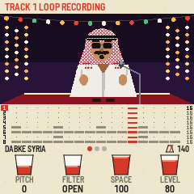

Tap SEQ while the loop plays: it stops, and is kept (TRACK 1 LOOP STOPPED). Tap it again: it plays again from the next bar (TRACK 1 LOOP PLAYING). With the rhythm stopped, the rhythm starts with it. SEQ is lit at a second level while the picked track's loop plays.

Hold SEQ a second: the track's loop is cleared, every take of it and its locks with it (TRACK 1 LOOP CLEARED). On a track with nothing of yours, the screen says TRACK 1: NO LOOP HERE. A drum track cleared follows the rhythm again. If the press had started the rhythm to play a stopped loop again, the clear stops the rhythm again.

SEQ acts on the press, so a recording starts and ends where you tap. The screen speaks when you let go, so holding SEQ to clear never says RECORDING. A press shorter than a second is a tap, and a hold on a playing loop first stops it, then clears it.

A track with a loop is not recorded over: SEQ stops it or plays it again. To record that track anew, clear it first. Your keys play over a loop that plays, and are not recorded.

Notes land on the nearest step of the rhythm, or of the arpeggio when it is on and faster. A recording keeps up to eight bars. At eight it closes by itself and plays, and the screen says so. One track records at a time: SEQ on another track's empty loop closes the recording that was going, which plays, and starts the new one. PLAY stopping the rhythm also closes a recording, and keeps it. A recording still waiting for its first key starts with the rhythm when PLAY starts it.

A drum track records the drums you play on the keys, each hit on the step it falls on. It is yours from the first hit. With the rhythm stopped, your first hit starts it. A drum track's loop is its own steps: SEQ stops them and plays them again as it does a loop, and SEQ held a second gives the track back to the rhythm.

While a track records, turning its PITCH, FILTER, SPACE, DELAY SEND or REVERB SEND (on the home page, or its MIDImix knobs) is kept as locks on the steps the recording passes, so the move comes back with the loop. Its LEVEL is not kept.

The loops play whenever the rhythm runs, apart from those SEQ stopped. A track holds up to 128 notes, and all the tracks 512: past that, NO ROOM FOR MORE NOTES.

---

## 12. Steps and locks

Hold EDIT a second for step mode (STEP MODE: WHITE KEYS ARE STEPS). It starts nothing: the rhythm and the loops go on as they were. HOME shows the step view of the picked track, and EDIT is lit at a second level. SEL held and a white key still picks another track.

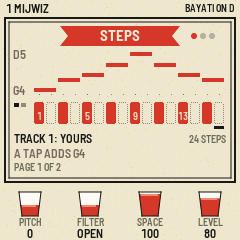

| Part | What it shows |
| --- | --- |
| Top line | The picked track and its sound, as on the home page. With a step held, that step's locks instead, in red. |
| Title | STEPS, and three dots for the home page's rows. |
| Upper half | A drum track: its drums lane by lane. A note track: its notes by pitch, as long as they sound. |
| Row of steps | The steps as the white keys have them: filled where something of yours begins, outlined where the rhythm plays, dotted where empty. A blue padlock on a locked step, a line under the step playing, a frame round the step held. A track longer than a page has a small box a page at the left: the one shown dark, the one playing red. |
| Lines of words | The track and whose it is (YOURS, THE RHYTHM'S or EMPTY) and its length. What a tap adds, and the track's locks counted. The page shown, as PAGE 1 OF 2. |
| K1 to K4 | The home page's row shown: the picked track's PITCH, FILTER, SPACE and LEVEL first. HOME again: the next row. |

### The white keys are steps

The 16 white keys are the steps of the page shown, from the left. A white key is lit where something begins, at a second level where a lock is, and dim on the step playing. The black keys go on playing the track's sound.

A page is a bar: 16 steps, or as many whole bars of the rhythm as fit in 16 (12 in 6/8, 14 in 7/8, 10 in 10/8). OCT- and OCT+ show the page before and after. OCT+ on a track one bar long gives it a second bar, with the first bar copied in if the second is empty. LENGTH (the EDIT page, row 1, K2) sets one bar or two, and for a loop played live, also the length it was played.

- Tap an empty step. A drum track gets the drum shown after A TAP ADDS: the drum you played last on it, or the one DRUM picks (the EDIT page, row 1, K3). A note track gets the notes frozen on it, or else the note or chord you played last on it, or else the maqam's tonic, one step long.
- Tap a step with something on it: it goes, and its locks with it.
- Hold a step and press keys. On a note track, their notes become the step's in place of what was there, up to four. On a drum track, the black key's drum becomes the step's only drum.
- A key held longer than 0.4 s and let go with nothing done changes nothing.

### Locks

Hold a step and turn a knob: that knob is locked on that step. From that step to the track's next step with a note or a hit, the knob holds the lock's value, then goes back. The top line names the step's locks, for example STEP 3: FILTER DARK 20, and the knob's value shows in blue. A small padlock by a knob's name means the track has a lock of that knob somewhere.

Most knobs that turn through values can be locked: K1 to K4 of the step view, the knobs of the SOUND, ORNAMENTS, EFFECTS and RHYTHM pages, and the MIDImix's knobs and faders. On a knob page in step mode, the track's steps show under the knobs, so you can hold a step and lock that page's knob. A lock of one of a sound's knobs, such as TONE or VIB DEPTH, works on the sound the page shows and no other: VIB DEPTH locked on a step of track 2, with SAZ on it, changes track 2's vibrato, and the other tracks keep theirs. When a control cannot be locked, the screen says so: the tempo, the rhythm, choices such as ORNAMENT, the MIXER's MUTE, FX and SOLO, the MASTER EQ and FADE are among them.

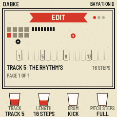

- An empty step held while a knob turns gets a lock and nothing else. Tap it to remove the lock.
- On a drum track, hold a step and turn SELECT: that step's hits play another drum sound, the track's own family first, then the other drum families. Turn back to the track's own sound to remove it. Note sounds cannot be locked to a step.
- EDIT with a step held removes that step's locks. SEQ held a second removes all the track's locks, with its loop.
- There is room for 240 locks in all. Past that, NO ROOM FOR MORE LOCKS.

Hold EDIT a second again to leave step mode (STEP MODE OFF). The track stays picked and the keys play it.

---

## 13. Freezing (REC)

REC freezes the picked track: the notes of its keys down sound on after you let go (TRACK 1 FROZEN). With no key down, REC freezes the note or chord you played last on that track, or else the maqam's tonic. REC is lit while the picked track holds anything, and the keys of its frozen notes are lit bright.

On a frozen track:

- A lead sound that plays one note at a time (PLAY on LEGATO or MONO, the arpeggio off): a key moves the frozen note to that key's note, with no new attack, and it stays frozen there.
- A POLY lead sound, the left hand and the bass line: each key you press is frozen too.
- Press the key of a frozen note again and that note stops, while the others go on. When the last one stops, the screen says TRACK 1 LET GO and the track is no longer frozen.

REC again lets everything on the track go (TRACK 1 LET GO). A drum sound holds no note: REC on a drum track says TRACK 5: A DRUM SOUND HOLDS NO NOTE.

Freeze several tracks and they sound together while the keys play another. REC ARM on the MIDImix freezes its strip's track, or lets it go, without picking it. Its light is lit while that track is frozen.

OCT- and OCT+ do not move frozen notes. The track's PITCH, its TRANSPOSE and TUNE, and a quarter tone set with EDIT do move them, and they stay there. A pitch wheel and the keys' pressure bend frozen notes only while you move them.

A new sound on a frozen track keeps its notes sounding, in the new sound. A drum sound holds no notes, so on a drum sound they stop (TRACK 3 LET GO).

With the arpeggio on, frozen notes go on arpeggiating: a key you add joins them, and the key of a frozen note takes it out. The arpeggio plays on one track at a time: a key on another track with a lead sound takes it there, and the frozen arpeggio is let go (TRACK 1 LET GO). On track 1 with LEFT KEYS on SPLIT or BASS, REC freezes the left keys too: a frozen left key keeps its chord for the bass and the backing. In step mode the white keys are steps, and the frozen notes are what a tap adds.

PLAY stops the frozen tracks with everything else, and brings them back (see PLAY).

---

## 14. PLAY

PLAY stops everything that sounds: the rhythm, the loops with it, the frozen tracks and a latched arpeggio playing on (ALL STOPPED). It remembers what it stopped. Press PLAY again and it all comes back (ALL BACK): the rhythm and the loops from the start of a bar, the frozen tracks on their notes, the arpeggio on its notes. With nothing to bring back, PLAY starts the rhythm, and the screen says its name, as in DABKE SYRIA PLAYS. So PLAY always plays.

If something PLAY stopped is still waiting while something else sounds, for example a track you froze since, PLAY brings back what it stopped first. The next PLAY stops all of it.

While the rhythm runs, PLAY acts when you let go of it. Hold it for 0.4 s instead and a fill-in plays in the last two beats of the bar (FILL IN), and nothing stops.

A loop recording when PLAY stops the rhythm closes there, and is kept. A recording still waiting for its first key is not sounding yet: with nothing else sounding, PLAY starts the rhythm and the recording with it; when PLAY stops other things, the waiting recording is dropped. PLAY is green while anything sounds.

The tracks PLAY stopped while frozen are kept with the settings: after the FM-1 is switched off and on, PLAY brings them back.

---

## 15. The arpeggio

Tap ARP to switch the arpeggio on or off (ARPEGGIO ON). It plays the keys you hold on a lead sound, track 1 or any track with a lead sound, a note at a time on its own grid. It keeps time with the rhythm when it runs, and with the tempo when not. Its notes keep their quarter tones, and a loop recorded on its track keeps them.

Hold ARP for its panel: eight controls in two rows. The row on K1 to K4 is dark, with its values in the glasses, and the other row is faint. SEL or SELECT moves to the other row. Let go of ARP after using the panel and the arpeggio stays on or off as it was. The same eight are on the SOUND page, rows 5 and 6.

| Control | Choices |
| --- | --- |
| ARP ORDER | UP, DOWN, UP DOWN, DOWN UP, AS PLAYED, ANY, CHORD (all the notes together), IN OUT, THUMB (the lowest note between each of the others). |
| ARP SPEED | QUARTERS, 8THS, TRIPLETS, 16THS (as DABKE starts), SEXTUPLETS, 32NDS. |
| ARP OVER | 1 OCT, 2 UP, 3 UP, 4 UP, 2 DOWN, 3 DOWN, 2 BOTH WAYS: the octaves it walks over. |
| ARP LENGTH | How long each note sounds, from 10 % of its step up to TIED, each note running into the next. |
| ARP PATTERN | ALL, 3-3-2, MAQSUM, SAIDI, GALLOP, OFFBEATS, PAIRS, ACCENTS: a rhythm of eight steps, with rests and accents. |
| ARP REPEAT | ONCE, TWICE, 3 TIMES, 4 TIMES: each note that many times before the next. |
| ARP SWING | AS RHYTHM, NONE, LIGHT, MEDIUM, HEAVY, FULL. |
| ARP LATCH | OFF or ON. ON: it goes on after you let go of the keys, and the next keys you press start a new set. PLAY stops it and brings it back. |

---

## 16. Saving

DABKE keeps everything you set by itself: every track's sound, every page's settings, the maqam, the rhythm and the tempo, each track's LEVEL, sends, FILTER, BASS, PITCH, MUTE and FX, the background's MUTE and FX, the MASTER EQ, the loops, the steps and the locks. They come back when the FM-1 starts.

It writes them a few seconds after your last change, in a quiet moment: with the rhythm stopped, nothing recording, no key down and the sound faded. Writing to the flash stops the sound for a moment, which is why it waits. Frozen notes never fade, so then it writes a minute after the change. So before you switch the FM-1 off, press PLAY to stop everything and wait a few seconds.

Some things are not kept: step mode, the SOLOs, which loops SEQ stopped, the MIDImix's master fader and FADE's place. DABKE starts with step mode off, nothing soloed, every loop ready to play with the rhythm, the whole level full and FADE at 0. Nothing sounds when it starts. The tracks PLAY stopped while frozen are kept, and PLAY brings them back. A track still frozen and sounding when the FM-1 goes off is not kept.

### From 0.19

DABKE 0.20 loads what 0.19 saved, whole: every track's sound, the loops, the steps, the locks and the kept sounds. In 0.19 one send a track, EFFECT, fed both the delay and the reverb, so each track's REVERB SEND starts where its EFFECT was. The MASTER EQ starts flat and every track's effects in. With ALL picked in 0.19, DABKE opens on track 1.

### Keep a sound

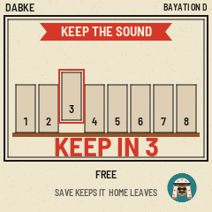

Press SAVE: the KEEP THE SOUND page shows eight places, red where a sound is kept, and opens on the first free one, slid out. Turn SELECT to pick a place (PLACE 3 FREE, or PLACE 3 USED) and press SAVE again: the screen says KEPT IN 3. On a used place, the first SAVE asks (PLACE 3 IS USED: SAVE AGAIN TO REPLACE), and SAVE again replaces it. HOME leaves without keeping. Any other button leaves too, and does its own job. SAVE keeps the sound the SOUND page shows: the picked track's, or track 1's (see The SOUND page).

To load a kept sound, turn SELECT on the home page: the kept sounds come after the ready ones, as MY SOUND 1 to MY SOUND 8. It goes on the picked track.

A kept sound holds a track's sound: its instrument and its settings, the vibrato and the ornaments. It also holds the effects on the EFFECTS page's first three rows, which come back only when you pick it on track 1. Picking a kept sound never changes another track's sound. A kept sound does not hold the loops, the steps, the rhythm or the maqam.

### Start fresh

To go back to how DABKE was on its first start, hold SAVE while you switch the FM-1 on, and keep holding it until the START FRESH page shows. It says what goes: every setting, every track's sound, the loops, the steps, the locks and the MY SOUNDs. Let go of SAVE and press it again to start fresh: the screen says STARTED FRESH and DABKE opens on the home page with its first ready sound, Dabke Syria at 140, no loops, no steps of yours, no locks and no MY SOUNDs. It stays that way when you switch the FM-1 off and on.

To keep everything, press HOME, or any other button: the screen says EVERYTHING KEPT and the home page opens as on any start. The keys and the knobs do nothing on this page.

Starting fresh rewrites only DABKE's own saves, in the places DABKE always saves to. The panel's calibration and what other firmwares keep in the rest of the flash stay as they are.

---

## 17. The SOUND page

Press ENV. The SOUND page shapes one track's sound, and holds the arpeggio's controls. The line under the title says whose sound it is:

- With a track picked that plays a lead sound, that track's, as in TRACK 3 BUZUQ.
- With a track picked that plays a drum, drone, left-hand or bass sound, track 1's, and the line says TRACK 1. INSTRUMENT there changes track 1. It never turns the picked track into a lead sound: SELECT on the home page does that (see Any sound on any track).

VEL AMOUNT is shared by all the tracks, and so is the arpeggio on rows 5 and 6. The dots by the title show the row, the one shown in red. Each knob of the row has a picture, with the row's name under them. The home page's PLAYING row (HOW OFTEN, VIB DEPTH, GLIDE, ORNAMENT) changes the same sound.

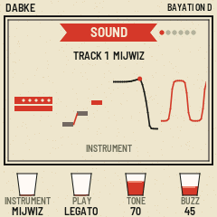

| Row | K1 | K2 | K3 | K4 |
| --- | --- | --- | --- | --- |
| 1 | INSTRUMENT | PLAY | TONE | BUZZ |
| 2 | PIPES APART | BREATH | BODY | DOUBLE |
| 3 | ATTACK | RELEASE | GLIDE | TRANSPOSE |
| 4 | TUNE | VEL AMOUNT | BEND RANGE | PICKING |
| 5 | ARP ORDER | ARP SPEED | ARP OVER | ARP LENGTH |
| 6 | ARP PATTERN | ARP REPEAT | ARP SWING | ARP LATCH |

| Knob | What it does |
| --- | --- |
| INSTRUMENT | The sound's instrument (see Sounds). Each comes with its own TONE, BUZZ, PIPES APART, BREATH, BODY, ATTACK, RELEASE, GLIDE and PLAY. |
| PLAY | LEGATO: one note at a time; a key pressed while another is held moves the note there without starting it again (the plucked instruments start again). MONO: one note at a time, each key starts it again. POLY: chords. |
| TONE | 0 to 100: darker to brighter. |
| BUZZ | 0 to 100: the reed's buzz. |
| PIPES APART | 0 to 40 cents: how far apart two pipes are tuned, for the beating of a mijwiz. |
| BREATH | 0 to 100: air in the sound. |
| BODY | 0 to 100: where the body's resonance sits, low to high. |
| DOUBLE | OFF, OCT DOWN, OCT UP: a second, softer note an octave down or up with each lead note. |
| ATTACK | 5 ms to 2.0 s. |
| RELEASE | 10 ms to 4.0 s. |
| GLIDE | 0 to 500 ms: how long each new lead note slides from the last one. |
| TRANSPOSE | -12 to +12 semitones, for this sound. Track 1's also moves the drone, the left hand and the bass line. The drums stay. |
| TUNE | -50 to +50 cents, for this sound. Track 1's also tunes the drone, the left hand and the bass line. |
| VEL AMOUNT | 0 to 100: how much the velocity changes the loudness. |
| BEND RANGE | 1/4 TONE, 1/2 TONE, 1 TONE, 1 1/2 TONE: how far key pressure and a MIDI pitch wheel bend this sound. Track 1's is also how far key pressure bends the left hand and the bass line. |
| PICKING | SINGLE or TREMOLO. With TREMOLO, a BUZUQ, OUD or QANUN sound is struck again and again while the key is held, at its ORN SPEED. |
| Rows 5 and 6 | The arpeggio (see The arpeggio). |

---

## 18. The ORNAMENTS page

Press LFO. The vibrato and the ornaments, the drone, and a few settings. Rows 1 and 2 edit the same track's sound as the SOUND page, and the line under the title says whose, as in TRACK 3 BUZUQ (see The SOUND page). PRESSURE, the drone and row 4 are shared by all the tracks.

| Row | K1 | K2 | K3 | K4 |
| --- | --- | --- | --- | --- |
| 1 | VIB SPEED | VIB DEPTH | VIB DELAY | ORNAMENT |
| 2 | ORN SPEED | HOW OFTEN | TRILL TO | PRESSURE |
| 3 | DRONE | SOUND | DRONE VOL | DRONE PITCH |
| 4 | HOME SCENE | (none) | USB PORT | KEY TOUCH |

| Knob | What it does |
| --- | --- |
| VIB SPEED | 2.0 to 9.0 Hz. |
| VIB DEPTH | 0 to 100. |
| VIB DELAY | 0 to 1.5 s: the sound's vibrato comes in after this long. The drone and the left hand get a lighter vibrato, from track 1's. |
| ORNAMENT | For lead sounds. OFF. MORDENT: a quick step up to the next note and back as each note starts. TURN: up, back, down, back. SCOOP: each note slides up into place. TRILL: the note and the next one in turn while the key is held. SHAKE: the pitch rocks up toward the next note and back while the key is held. AUTO, as DABKE starts: now and then, as HOW OFTEN says, a grace note, a scoop, a turn or two graces, and on some held notes a shake. |
| ORN SPEED | 4.0 to 24.0 Hz: how fast the ornaments move, and the TREMOLO picking. |
| HOW OFTEN | 0 to 100 %: how often AUTO ornaments a note. |
| TRILL TO | The neighbouring notes the ornaments go to: NEXT NOTE (the maqam's own neighbours, as tuned), 1/2 TONE or 1/4 TONE. |
| PRESSURE | NOTHING, BEND UP, BEND DOWN, VIBRATO, BRIGHTER (see Velocity and key pressure). |
| DRONE, SOUND, DRONE VOL, DRONE PITCH | The drone (see The drone). |
| HOME SCENE | PORTRAIT, STAGE, DANCERS, CASSETTE: the picture on the home page. |
| USB PORT | COMPUTER, as DABKE starts, or AUTO (see The Akai MIDImix). Also on the MAQAM page's TUNING row. |
| KEY TOUCH | PLAIN or VELOCITY (see Velocity and key pressure). Also on the MAQAM page's TUNING row. |

---

## 19. The EFFECTS page

Press FX. FX again shows the next row, when you let go of it, and SELECT turns the rows too. Hold FX a second and the row shown goes back to its start values, as DABKE starts them: the screen says so, as in DELAY AND REVERB RESET, and the row stays shown.

The first three rows and the MASTER EQ work on the whole song and are the same whichever track is picked. A ready sound or a MY SOUND picked on track 1 sets the first three rows; picked on any other track, it leaves them as they are. Rows 4 and 5 are the picked track's own, and their title says whose, as in TRACK 3 SENDS.

| Row | K1 | K2 | K3 | K4 |
| --- | --- | --- | --- | --- |
| 1 DELAY AND REVERB | DELAY | DELAY TIME | REPEATS | REVERB |
| 2 WEDDING PA | DRIVE | CHORUS | WEDDING PA | BRIGHTNESS |
| 3 TAPE | WOBBLE | TAPE AGE | HISS | DELAY SYNC |
| 4 SENDS | DELAY SEND | REVERB SEND | SPACE | (none) |
| 5 TONE | FILTER | BASS | PITCH | LEVEL |
| 6 MASTER EQ | LOW | MID | HIGH | (none) |

| Knob | What it does |
| --- | --- |
| DELAY | 0 to 100: the echo's level. |
| DELAY TIME | 60 to 700 ms. Changing it bends what is already in the echo, as a tape echo does. With DELAY SYNC on 1/8, 3/16 or 1/4 it shows `--`, and turning it says DELAY SYNC SETS THE TIME. |
| REPEATS | 0 to 90. |
| REVERB | 0 to 100: a hall. Each track's DELAY SEND and REVERB SEND set how much of it goes into the delay and into the reverb. |
| DRIVE | 0 to 100: the lead, the drone and the left hand pushed into distortion. The bass and the drums stay clean. |
| CHORUS | 0 to 100, on the lead, the drone and the left hand. |
| WEDDING PA | 0 to 100: the whole sound through a wedding hall's PA, with no lows, a horn's honk, pushed hard, with the hall's slap-back. |
| BRIGHTNESS | 0 to 100: a filter on the whole sound. 100 is open. |
| WOBBLE | 0 to 100: the pitch wobbles, as on an old cassette. |
| TAPE AGE | 0 to 100: a worn tape, saturated, with fewer highs and lows. |
| HISS | 0 to 100: tape hiss. |
| DELAY SYNC | OWN TIME (DELAY TIME), or 1/8, 3/16, 1/4: the echo in time with the tempo. |
| DELAY SEND, REVERB SEND, SPACE | The picked track's sends, as on the home page (see The home page). |
| FILTER, BASS, PITCH, LEVEL | The picked track's tone and level, as on the home page. |
| LOW | A shelf under 250 Hz. |
| MID | A wide bell at 1 kHz. |
| HIGH | A shelf over 3.5 kHz. |

The MASTER EQ is the last thing on the whole sound, after every effect. LOW, MID and HIGH each go from -24 dB, shown as OFF (that band about 40 dB down), to +12 dB. While all three are at 0 dB, the MASTER EQ is out of the sound.

### The background's rows

Hold SEL and press the ninth white key, G4: rows 4 and 5 become the background's, the rhythm's drums, which are every track with a drum sound. BACKGROUND SENDS has DELAY SEND, REVERB SEND and SPACE, moving all the drum tracks' sends together. BACKGROUND TONE has KIT TONE, LOW / HIGH and KIT TUNE, as on the RHYTHM page, row 7, and DRUMS, the volume of all the drums together. With no drum sound on any track, the sends show `--`, and turning them says NO TRACK HAS A DRUM SOUND. Hold SEL and press a track's key to give the rows back to that track.

---

## 20. The RHYTHM page

Press GLO. GLO again shows the next row. SELECT turns the rhythm, as PRESET does. The page has the rhythm's feel, its added voices and fill-ins, the left hand, and the drum kit.

| Row | K1 | K2 | K3 | K4 |
| --- | --- | --- | --- | --- |
| 1 | SWING | ACCENT | VARIATION | LOOSENESS |
| 2 | ADD CLAPS | ADD RIQ | ADD SAGAT | ADD KICK |
| 3 | AUTO FILL | FILL IS | ADD RHYTHM | SYNC START |
| 4 | LEFT KEYS | BASS PLAYS | BACKING | CHORD TYPE |
| 5 | LEFT SOUND | BASS SOUND | BASS TONE | BASS DECAY |
| 6 | DRUM | DRUM LEVEL | DRUM TUNE | DRUM DECAY |
| 7 | KIT TUNE | KIT LENGTH | KIT TONE | LOW / HIGH |
| 8 | KICK | DARBUKA | CLAPS | RIQ, SAGAT |

| Knob | What it does |
| --- | --- |
| SWING | 0 to 100: every second step a little late. CHAABI 6/8 does not swing. |
| ACCENT | 0 to 100: how much louder the accented hits are. |
| VARIATION | PLAIN. BUSY: the ka fills every gap, the riq on every second step. HEAVY: the tabl and the kick double the dums, the tabl's stick and the claps double the teks. BY ITSELF: busy every fourth bar, heavy in the sixth of every eight. |
| LOOSENESS | 0 to 100: each hit a little louder or softer, at random. |
| ADD CLAPS | Claps with the teks. |
| ADD RIQ | The riq on the eighths. |
| ADD SAGAT | The sagat on every beat, and in most rhythms on the half beats too. |
| ADD KICK | A kick on every beat. |
| AUTO FILL | NEVER, 2 BARS, 4 BARS, 8 BARS, 16 BARS: a fill-in every that many bars. |
| FILL IS | ROLL: tek and ka in turn, louder and louder, a dum on each beat. BREAK: silence, then tek, slap, clap and stick together on the last step. STOPS: the band hits each beat together. |
| ADD RHYTHM | NONE, or a second rhythm playing along with the first. The bottom line shows both. |
| SYNC START | OFF or ON (see The left hand, bass and backing). |
| LEFT KEYS, BASS PLAYS, BACKING, CHORD TYPE | See The left hand, bass and backing. |
| LEFT SOUND | Track 3's sound: the lead's thirteen instruments. STRINGS as DABKE starts. |
| BASS SOUND | ROUND, SYNTH, BUZZ, WOODY, PICKED. |
| BASS TONE | 60 to 2500 Hz: how bright the bass is. |
| BASS DECAY | 30 % to 300 %: how long the bass note's pluck lasts. |
| DRUM | One of the thirteen drums for the next three knobs: DUM, TEK, KA, SLAP, TABL, STICK, RIQ, DAF, SAGAT, KICK, CLAP, SNARE, SHAKER. |
| DRUM LEVEL | 0 to 100. |
| DRUM TUNE | 25 % to 400 %. |
| DRUM DECAY | 20 % to 500 %. |
| KIT TUNE | 50 % to 200 %: every drum. |
| KIT LENGTH | 40 % to 250 %: every drum's decay. |
| KIT TONE | 0 to 100: the drums' highs. 100 is open. |
| LOW / HIGH | -100 to +100: the balance between the low drums (dum, tabl, daf, kick) and the others. Above 0 the low drums go down, below 0 the others. |
| Row 8 | KICK, DARBUKA, CLAPS and RIQ, SAGAT: the volumes of tracks 5 to 8, the same as their LEVEL on the MIXER and their MIDImix faders. |

The rhythm's added voices, variations and fill-ins play only on the tracks that follow the rhythm, never on yours.

---

## 21. The EDIT page and the MIXER

Tap EDIT: the EDIT page. EDIT again shows its next row, and SELECT turns the rows too. Held a second, EDIT turns step mode on or off instead (see Steps and locks). Held while you press a key, it tunes that key (see A quarter tone on any note).

| Row | K1 | K2 | K3 | K4 |
| --- | --- | --- | --- | --- |
| 1 STEPS | TRACK | LENGTH | DRUM | PITCH STEPS |
| 2 SCENE | FADE | TOP SOUND | (none) | (none) |
| 3 MIXER | LEVEL | FX | MUTE | SOLO |

| Knob | What it does |
| --- | --- |
| TRACK | The picked track, TRACK 1 to TRACK 8, as SEL held with a white key picks it. |
| LENGTH | The picked track one bar long or two, shown in steps (16 STEPS). A loop played live can also be as long as it was played (64 PLAYED). |
| DRUM | The drum a tapped step gets on a drum track. On a note track: THE KEYS. |
| PITCH STEPS | FULL: the PITCH knobs and the MIDImix's top knobs move by semitones. MICRO: by quarter tones. The same knob as on the MAQAM page. |
| FADE | The scene fader, 0 to 100, TOP from 97 up (see The scene). |
| TOP SOUND | NONE, or TURN: CLEAR. Turn it to clear the top sound. |
| LEVEL, FX, MUTE, SOLO | The MIXER (below). |

### The MIXER

The MIXER is the EDIT page's last row: press EDIT until the screen says EDIT: TRACK 1 MIXER. Its knobs act on the picked track.

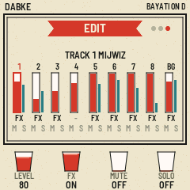

The page shows the eight tracks and the background, BG, side by side. Each has its LEVEL as a red fader, grey while it is silent (muted, or another track soloed), with how loud it plays now beside it. Under it, FX (faint while its effects are out, - while it has none set), then M on a dark box while it is muted and S on a red one while it is soloed. The picked track's number is red, and its name and sound are on top. While any track is soloed, SOLO ON shows above them in red.

| Knob | What it does |
| --- | --- |
| LEVEL | The track's volume, 0 to 100, as its MIDImix fader. |
| FX | Left: the track's effects out, its delay and reverb sends and its BASS, each kept as set (TRACK 3: EFFECTS OFF). Right: back in (TRACK 3: EFFECTS ON). It shows `-` while the track has none of them set. |
| MUTE | Right: the track muted (TRACK 3: MUTE ON). Left: on again (TRACK 3: MUTE OFF). |
| SOLO | Right: the track soloed (TRACK 2: SOLO ON), and only soloed tracks are heard. Left: off. With several soloed, all of them are heard. |

A muted track is silent from its next note's first sample, and its lane on the home page is dimmed. MUTE and FX are kept with the settings. SOLO never is: after a power-off, nothing is soloed.

Hold SEL and press the ninth white key, G4, for the background's MIXER (BACKGROUND MIXER). LEVEL is then DRUMS, the volume of all the drums together, and FX, MUTE and SOLO act on every track with a drum sound, as in BACKGROUND MUTE ON. Hold SEL and press a track's key to give the row back to that track.

### The scene

FADE moves between two settings of the tracks: the sound as set, and a top sound. Each track's DELAY SEND, FILTER, PITCH and LEVEL can have a top value.

1. Turn FADE to its top, 97 and up. The screen says FADER UP: THIS IS THE TOP SOUND.
2. Move the controls you want to change, on the home page or on the MIDImix's strips: you set their top values.
3. Turn FADE down: the sound as set (FADER DOWN: THE SOUND AS SET). In between, those controls move from their set values toward their top values.

Turn TOP SOUND to clear the top sound (TOP SOUND CLEARED). The top sound is kept with the settings. FADE's place is not: DABKE starts with it at 0.

---

## 22. The Akai MIDImix

An Akai MIDImix on the FM-1's USB port works as DABKE's mixer: a strip for each track. Nothing on DABKE works only from the MIDImix. Every control has its place on the FM-1 too.

To use it, set USB PORT (the ORNAMENTS page, row 4, K3) to AUTO and plug the MIDImix into the FM-1's USB port. With AUTO and no computer on the port, the port looks for a controller in turns, from 30 seconds after the FM-1 starts. The screen says CONTROLLER READY when it finds one, and CONTROLLER UNPLUGGED when it goes. With COMPUTER, as DABKE starts, the port stays a computer's. In AUTO the port also takes another USB MIDI controller, such as a keyboard.

DABKE reads the MIDImix as it comes from the factory, on channel 1.

| MIDImix | What it does | On the FM-1 |
| --- | --- | --- |
| Strips 1 to 8 | Tracks 1 to 8. Nothing on a strip picks its track. | The picked track: SEL held and a white key |
| Fader | The track's LEVEL. | K4 on the home page, or LEVEL on the MIXER |
| Top knob | The track's PITCH: in tune in the middle, an octave down or up at the ends, in steps as PITCH STEPS says. | K1 on the home page |
| Middle knob | The track's FILTER. | K2 on the home page |
| Bottom knob | The track's SPACE: its delay and reverb sends together. | K3 on the home page |
| SOLO | Tapped: the knobs' EFFECTS layer. The top knob is then the track's DELAY SEND, the middle knob DELAY TIME (the one delay all the tracks share: any strip's middle knob sets it), the bottom knob the track's REVERB SEND. BANK LEFT and RIGHT are lit while the knobs are on it. Tapped again: back. | The home page's MIX row; DELAY TIME on the EFFECTS page, row 1 |
| MUTE | The track muted, or on again. Lit while it is muted. | MUTE on the MIXER |
| REC ARM | Freezes the track, or lets it go, as REC does. Lit while the track holds anything. | REC |
| BANK LEFT, BANK RIGHT | The picked track's sound before or after. | SELECT on the home page |
| Master fader | The whole level, live. Never kept: full again when the FM-1 starts and when the MIDImix is unplugged. | MASTER |

The master fader is no longer the scene fader: that is FADE, on the EDIT page (see The scene).

A fader or a knob moves its own strip's track and never picks it: the keys stay where they are while you ride another track. The screen says what moved, for example TRACK 6: LEVEL 70. SOLO says which layer the knobs are on: KNOBS: EFFECTS DELAY, TIME, REVERB, or KNOBS: PITCH FILTER, SPACE. The SEND ALL button sends every value at once: DABKE takes them all and says nothing. No light blinks: each one shows what its label says. The MIDImix lights SOLO only while it is held, so BANK LEFT and RIGHT show the EFFECTS layer instead.

In step mode, with a step held, a strip's knob or fader is locked on that step. While a track records its loop, its knobs are kept as locks on the steps the recording passes. Its fader is not.

---

## 23. MIDI and USB audio

On a computer, the FM-1 shows up as DABKE FM-1. DABKE has no Bluetooth.

MIDI comes in over USB and the FM-1's TRS MIDI jack. Notes on any channel play the picked track, as the keys would. With track 1 picked and LEFT KEYS on SPLIT or BASS, notes under C4 go to the left hand. Notes under E1 do not play: on channel 1 they are the MIDImix's buttons. A pitch wheel bends the lead sounds, each by its own BEND RANGE, and a mod wheel adds vibrato. Notes from MIDI get the maqam's quarter tones too.

The MIDImix's messages work from any MIDI input on channel 1, so a computer can send them: the strips' knobs and faders as control changes 16 to 31 and 46 to 61, the master fader as 62, and the buttons as notes 1 to 27.

MIDI goes out over USB: the keys' notes on channel 1, with the velocity they were played at and the octave. Drum keys and the steps in step mode send nothing, and the pressure is not sent. DABKE keeps its own tempo: it does not follow MIDI clock and does not send it.

Over the USB cable the FM-1 is also a sound card. Your computer can record DABKE from the input named DABKE FM-1. It records DABKE alone, at MASTER's volume, never what the computer plays. The computer can also play through the FM-1: choose DABKE FM-1 as its output, and you hear it from the FM-1's speaker and headphones, mixed with DABKE, at MASTER's volume.

---

## 24. Troubleshooting

**No sound.** Turn MASTER up, and the MIDImix's master fader if one is plugged in. A track's LEVEL is K4 on the home page, or its MIDImix fader. A muted track's lane is dimmed: switch it on with MUTE on the MIXER (the EDIT page's last row), or MUTE on the MIDImix. While any track is soloed, only the soloed ones are heard. The background's MUTE silences every track with a drum sound.

**A note goes on after I let go.** The track is frozen, and REC is lit. Press that note's key again, or REC, to let it go. PLAY stops every frozen track.

**SEQ does not record.** The track has a loop already, and SEQ stops it or plays it again. Hold SEQ a second to clear it, then tap SEQ to record.

**A key does not bend.** Only F3 to C5 sense pressure: the top seven keys, C#5 to G5, do not. Check that PRESSURE is not on NOTHING (the ORNAMENTS page, row 2, K4). Drum tracks have no pressure, a loop playing back does not bend, and the drone does not bend. BRIGHTER does not change ORGAN, BUZUQ, OUD, QANUN or the bass sounds.

**The drone is silent.** Check DRONE and DRONE VOL (the ORNAMENTS page, row 3). The drone sounds only while you play the lead, the rhythm runs, the left hand holds a chord, or you play its track.

**A left key does not start the rhythm.** SYNC START needs track 1 picked, LEFT KEYS on SPLIT or BASS, and step mode off.

**The MIDImix does nothing.** Set USB PORT to AUTO. With a computer on the port, the port stays the computer's. After the FM-1 starts, the port looks for a controller only after 30 seconds. Wait for CONTROLLER READY.

**My changes were not kept.** DABKE saves only with the rhythm stopped and the sound quiet. Press PLAY to stop everything and wait a few seconds before you switch the FM-1 off.

**DABKE started fresh.** Another firmware installed since may have written over DABKE's saves (see Install).

**Notes stop early.** DABKE plays up to 16 notes at once besides the drone, and fewer when the FM-1 is busy. The oldest note stops first.

**NO ROOM FOR MORE NOTES, NO ROOM FOR MORE LOCKS.** A track holds 128 notes, all the tracks 512, and all the locks 240. Clear a loop you no longer need (SEQ held a second on its track), or remove some steps or locks.

**CANNOT BE LOCKED TO A STEP.** That control cannot hold a value of its own on a step. The tempo, the rhythm, choices such as ORNAMENT, the MIXER's MUTE, FX and SOLO, the MASTER EQ and FADE are among them.

**The installer does not find the FM-1.** Use Chrome or Edge, and allow MIDI when the browser asks. Close other programs that use the FM-1's MIDI port.

**DABKE SAFE MODE on the screen.** DABKE failed twice while starting. There is no sound, but USB works: install DABKE again from the web installer. PLAY tries starting DABKE again. REC puts the FM-1 in the chip's own update mode.

---

## 25. Credits

DABKE is made by STUDIOMORPHIK and built on fm1-base by Charles Vestal and felucca-bsp, from Felucca by Leo Kuroshita (Hügelton Instruments). Licence MPL-2.0. Source at [github.com/wissamsader/dabke](https://github.com/wissamsader/dabke).
